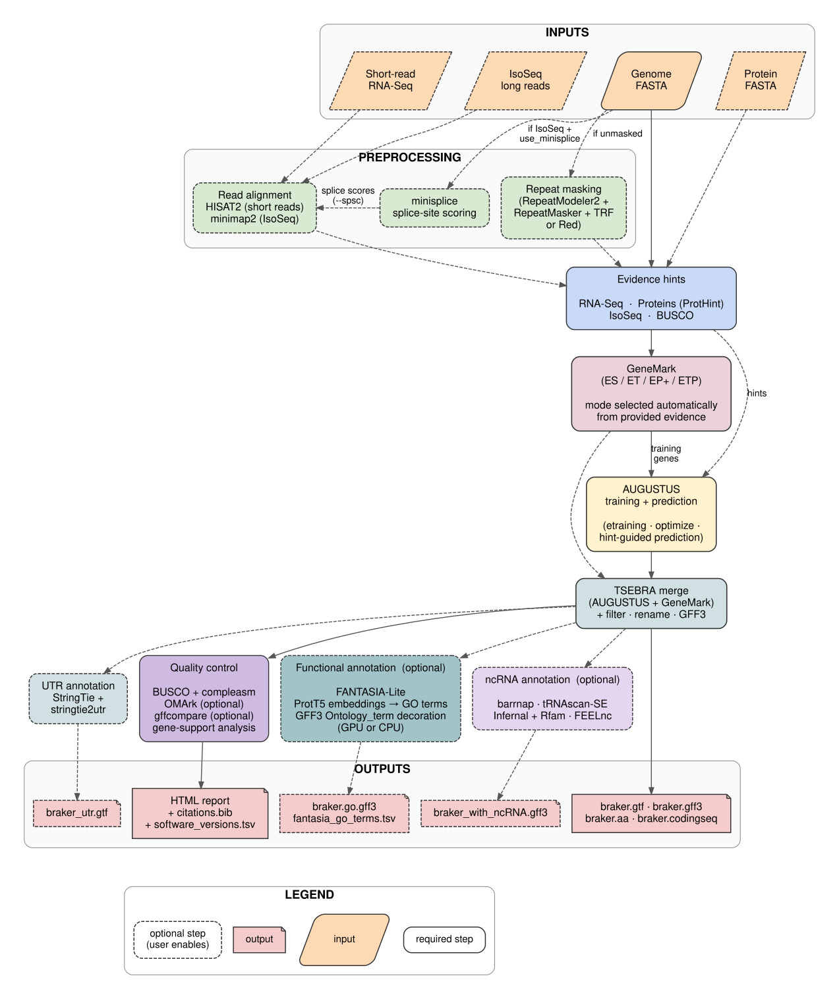

<p align="center"></p>

<p align="center">
  <a href="https://github.com/Gaius-Augustus/BRAKER4/releases"></a>
  <a href="LICENSE"></a>
  
  
  <a href="https://github.com/Gaius-Augustus/BRAKER4/commits/main"></a>
  <a href="https://github.com/Gaius-Augustus/BRAKER4/issues"></a>
  <a href="https://github.com/Gaius-Augustus/BRAKER4/stargazers"></a>
</p>

# BRAKER4 - an improved BRAKER pipeline rewritten in Snakemake with native Singularity support

Authors: Henning Krall and Katharina J. Hoff

Contact for Repository
========================

Katharina J. Hoff, University of Greifswald, Germany, katharina.hoff@uni-greifswald.de, +49 3834 420 4624

**Commercial use:** While BRAKER4 itself is under MIT license, GeneMark is not free for commercial use. If you intend to use BRAKER4 for commercial purposes, please contact the **GeneMark authors** Mark Borodovsky or Alex Lomsadze for a commercial license.

> **Migrating from native BRAKER3 (`braker.pl`)?** The fastest path to your first BRAKER4 run is the dedicated step-by-step tutorial: **[MIGRATING_FROM_BRAKER3.md](MIGRATING_FROM_BRAKER3.md)**. It maps every `braker.pl` flag you already use to the equivalent `samples.csv` column or `config.ini` parameter, and walks through ET, EP, ETP, and ES translations with concrete examples. For IsoSeq it lists the two `samples.csv` columns to fill.

Contents
========

-   [What is different in BRAKER4?](#what-is-different-in-braker4)
-   [Benchmark accuracy vs native braker.pl](#benchmark-accuracy-vs-native-brakerpl)
-   [What is BRAKER?](#what-is-braker)
-   [Keys to successful gene prediction](#keys-to-successful-gene-prediction)
-   [Overview of modes for running BRAKER4](#overview-of-modes-for-running-braker4)
-   [Protein database preparation](#protein-database-preparation)
-   [Installation](#installation)
    -   [Snakemake](#snakemake)
    -   [Singularity](#singularity)
    -   [Version fragility warning](#version-fragility-warning)
-   [Running BRAKER4](#running-braker4)
    -   [Preparing input files](#preparing-input-files)
        -   [samples.csv](#samplescsv)
        -   [config.ini](#configini)
    -   [Running locally](#running-locally)
    -   [Running on an HPC cluster with SLURM](#running-on-an-hpc-cluster-with-slurm)
    -   [BRAKER4 pipeline modes](#braker4-pipeline-modes)
        -   [BRAKER4 with RNA-Seq data (ET mode — BRAKER1 equivalent)](#braker4-with-rna-seq-data-et-mode--braker1-equivalent)
        -   [BRAKER4 with protein data (EP mode — BRAKER2 equivalent)](#braker4-with-protein-data-ep-mode--braker2-equivalent)
        -   [BRAKER4 with RNA-Seq and protein data (ETP mode — BRAKER3 equivalent)](#braker4-with-rna-seq-and-protein-data-etp-mode--braker3-equivalent)
        -   [BRAKER4 with PacBio IsoSeq and protein data](#braker4-with-pacbio-isoseq-and-protein-data)
        -   [BRAKER4 with IsoSeq, short-read RNA-Seq, and protein data (dual mode)](#braker4-with-isoseq-short-read-rna-seq-and-protein-data-dual-mode)
        -   [BRAKER4 with genome only (ES mode)](#braker4-with-genome-only-es-mode)
        -   [Automatic mode fallback](#automatic-mode-fallback)
    -   [Description of selected configuration options](#description-of-selected-configuration-options)
-   [Output of BRAKER4](#output-of-braker4)
-   [Example data](#example-data)
-   [Bug reporting](#bug-reporting)
    -   [Common problems](#common-problems)
-   [Citing BRAKER and software called by BRAKER](#citing-braker-and-software-called-by-braker)
-   [License](#license)
-   [Funding](#funding)
-   [Acknowledgements](#acknowledgements)
-   [Related Software](#related-software)
-   [Usage of AI](#usage-of-ai)
-   [Developer Notes](#developer-notes)

What is different in BRAKER4?
=============================

BRAKER4 is a complete rewrite of the BRAKER pipeline in Snakemake. The gene prediction logic is the same: GeneMark trains on extrinsic evidence, AUGUSTUS is trained on GeneMark predictions, and TSEBRA merges the results. What changed is how this logic is orchestrated.

**The old BRAKER** was a monolithic Perl script (`braker.pl`, ~400 KB). It managed all tool calls, error handling, and file paths in a single script. We had containerized it for ease of use but it was impossible to restart after a bugfix, and it was hard to maintain and extend. Also, it did not spawn across nodes, leading 
to timeouts on large genomes with much evidence.

**BRAKER4** replaces that script with a Snakemake workflow. All bioinformatics tools run inside Singularity containers. You do not install GeneMark, AUGUSTUS, or any of their dependencies on your system. Snakemake handles job scheduling, parallelization, and automatic resume after failures.

Key differences:

-   **CSV-based multi-sample input.** You can annotate multiple genomes in a single run. Each row in `samples.csv` defines one genome with its evidence.

-   **Automatic resume.** If a run fails (out of memory, time limit, network error), re-run the same command. Snakemake picks up where it left off. There is no need to manually supply intermediate results from a previous run.

-   **Modular rules.** Each step is a separate Snakemake rule in its own file. This makes it straightforward to understand what each step does, to debug failures, and to extend the pipeline.

-   **HPC-ready with SLURM.** Snakemake's SLURM executor submits each rule as a separate cluster job. You do not need to wrap BRAKER in a SLURM script.

-   **Automatic repeat masking.** If you provide an unmasked genome, BRAKER4 runs RepeatModeler2 and RepeatMasker before gene prediction. Red (REpeat Detector) is available as a much faster alternative via `masking_tool = red`. You can also provide a pre-masked genome to skip this step entirely.

-   **Optional non-coding RNA prediction.** When `run_ncrna = 1` is set in `config.ini`, BRAKER4 predicts rRNAs with pybarrnap, tRNAs with tRNAscan-SE, non-coding RNA families with Infernal against Rfam, and (when transcript evidence is available) long non-coding RNAs with FEELnc. All four predictors' results are merged into a single `braker_with_ncRNA.gff3`. By default (`run_ncrna = 0`), no ncRNA prediction is performed and only the protein-coding gene set is produced.

-   **Automated RNA-Seq sampling.** If you do not have RNA-Seq data at hand, BRAKER4 can use VARUS to automatically select and download suitable RNA-Seq libraries from NCBI's SRA for your species. Just provide the genus and species name in `samples.csv`. For very large local RNA-Seq data sets, `varus_fastq = 1` lets VARUS sample batches of reads from your own FASTQ libraries instead of aligning them in full.

-   **Automatic UTR decoration.** If transcriptome data is provided, StringTie2 assembles transcripts and decorates all protein coding gene models that have support by evidence with UTRs if possible. A UTR stops before the nearest gene on the same strand that has its own transcript support, so read-through assemblies do not turn a neighbouring gene into UTR. In dual mode (short reads + IsoSeq), the IsoSeq reads are also assembled on their own, and their UTRs take priority wherever they match a gene.

-   **Integrated postprocessing and quality control.** GFF3 conversion (AGAT) is performed automatically. BUSCO completeness assessment (BUSCO & compleasm), OMArk scoring, and optional evaluation against a reference annotation (gffcompare) provide quality control.

-   **IsoSeq support.** BRAKER4 natively supports PacBio IsoSeq long reads, both as pre-aligned BAM and as unaligned FASTA/FASTQ (aligned with minimap2 ≥ 2.29, with optional minisplice splice-site scoring via `use_minisplice = 1`). You can combine IsoSeq with short-read RNA-Seq in a dual-ETP mode.

Benchmark accuracy vs native braker.pl
======================================

To verify that BRAKER4 reproduces the gene-prediction accuracy of the original `braker.pl` Perl pipeline, we run the same *Arabidopsis thaliana* genome (TAIR10 assembly, ~121 Mb) through both pipelines with matched configurations and score the resulting gene sets against the Phytozome Araport11 reference annotation using `gffcompare` v0.12.6 at the CDS level.

**Inputs (identical for both pipelines):** TAIR10 genome FASTA, VARUS-sampled RNA-Seq BAM (~4.8 GB), close relative proteins (e.g. *Brassica rapa*, for details see Tiberius parameters manuscript, this is not how we typically run BRAKER, it was a convenience choice because we already had the native BRAKER3 accuracy metrics prepared) . Native `braker.pl` is invoked without `--busco_lineage` and with `--skipOptimize`; BRAKER4 is configured with `use_compleasm_hints = 0` (compleasm still runs for QC and `best_by_compleasm` rescue, but its CDSpart hints are not fed to AUGUSTUS) and `skip_optimize_augustus = 1` so the two pipelines see the same hint stream and run the same training procedure. Results are scored with `gffcompare --strict-match -e 3 -T`.

<table>
  <thead>
    <tr>
      <th rowspan="2">Mode</th>
      <th colspan="2" align="center">Locus Sn</th>
      <th colspan="2" align="center">Locus Pr</th>
      <th colspan="2" align="center">Locus F1</th>
      <th colspan="2" align="center">Exon Sn</th>
      <th colspan="2" align="center">Exon Pr</th>
      <th colspan="2" align="center">Exon F1</th>
    </tr>
    <tr>
      <th>BRAKER3</th><th>BRAKER4</th>
      <th>BRAKER3</th><th>BRAKER4</th>
      <th>BRAKER3</th><th>BRAKER4</th>
      <th>BRAKER3</th><th>BRAKER4</th>
      <th>BRAKER3</th><th>BRAKER4</th>
      <th>BRAKER3</th><th>BRAKER4</th>
    </tr>
  </thead>
  <tbody>
    <tr>
      <td>ET</td>
      <td align="right">76.5</td><td align="right"><b>77.8</b></td>
      <td align="right">63.5</td><td align="right"><b>64.0</b></td>
      <td align="right">69.4</td><td align="right"><b>70.3</b></td>
      <td align="right">84.1</td><td align="right"><b>84.4</b></td>
      <td align="right">77.0</td><td align="right"><b>77.1</b></td>
      <td align="right">80.4</td><td align="right"><b>80.6</b></td>
    </tr>
    <tr>
      <td>EP</td>
      <td align="right">80.9</td><td align="right"><b>81.3</b></td>
      <td align="right">65.7</td><td align="right">64.8</td>
      <td align="right">72.5</td><td align="right">72.1</td>
      <td align="right">84.0</td><td align="right"><b>84.1</b></td>
      <td align="right">81.1</td><td align="right">81.1</td>
      <td align="right">82.5</td><td align="right"><b>82.6</b></td>
    </tr>
    <tr>
      <td>ETP</td>
      <td align="right">80.3</td><td align="right"><b>80.6</b></td>
      <td align="right"><b>78.6</b></td><td align="right">78.4</td>
      <td align="right">79.4</td><td align="right"><b>79.5</b></td>
      <td align="right">81.6</td><td align="right"><b>81.8</b></td>
      <td align="right">93.3</td><td align="right">93.3</td>
      <td align="right">87.1</td><td align="right">87.1</td>
    </tr>
  </tbody>
</table>

F1 = 2·Sn·Pr / (Sn + Pr), the harmonic mean of sensitivity and precision.

**Reading the table.** Sensitivity (Sn) is the percentage of reference loci (or exons) correctly recovered; precision (Pr) is the percentage of predicted loci (or exons) that match the reference. Higher is better for both.

ET and EP modes have low locus precision (~63–66%) in both pipelines because without the complementary evidence type, AUGUSTUS predicts many loci that are not in the curated Araport11 reference. This is a property of those modes generally, not a pipeline-specific issue.

In ETP mode, BRAKER4 matches native braker.pl on locus F1 (79.5 vs 79.4) and ties on exon F1 (87.1). Across all three modes (ET, EP, ETP), BRAKER4 either matches or slightly beats the original braker.pl Perl pipeline. Both pipelines were run with AUGUSTUS `optimize_augustus.pl` disabled (`--skipOptimize` / `skip_optimize_augustus = 1`); we verified that enabling it does not meaningfully change accuracy.

What is BRAKER?
===============

The rapidly growing number of sequenced genomes requires fully automated methods for accurate gene structure annotation. With this goal in mind, we developed BRAKER, a combination of GeneMark and AUGUSTUS that uses genomic and extrinsic evidence data to automatically generate full gene structure annotations in novel genomes.

BRAKER supports several types of extrinsic evidence:

-   **Transcriptome data** (Illumina short reads or PacBio IsoSeq long reads.)
-   **Protein sequences** (a large database such as OrthoDB, with many representatives per protein family)

The pipeline trains GeneMark on the evidence, selects high-confidence gene predictions for training AUGUSTUS, and then predicts genes with AUGUSTUS using the same evidence as hints.

<p align="center">
  
  <br>
  <em>Figure&nbsp;1. High-level overview of the BRAKER4 pipeline. Solid borders mark required steps; dashed borders mark optional steps that the user enables (e.g. repeat masking, ncRNA annotation, OMArk, gffcompare). GeneMark runs in one of several modes (ES / ET / EP+ / ETP) depending on the evidence provided in <code>samples.csv</code>. For the full Snakemake DAG of every rule and dependency, see the per-scenario rulegraphs in <code>test_scenarios/</code> and <code>test_scenarios_local/</code>; the <a href="test_scenarios/scenario_12_multi_mode/rulegraph.png">multi-mode rulegraph</a> shows all 6 BRAKER modes (ES, ET, EP, ETP, IsoSeq, dual) plus repeat masking and QC in a single DAG.</em>
</p>

Keys to successful gene prediction
===================================

-   Use a high quality genome assembly. If you have a huge number of very short scaffolds in your genome assembly, those short scaffolds will likely increase runtime dramatically but will not increase prediction accuracy.

-   Use simple scaffold names in the genome file (e.g. `>contig1` will work better than `>contig1my custom species namesome putative function`). Make the scaffold names in all your FASTA files simple before running any alignment program.

-   The genome should be masked for repeats. This avoids the prediction of false positive gene structures in repetitive and low complexity regions. Soft-masking (lowercase repeat regions) leads to better results than hard-masking (letters replaced with `N`). If you leave the `genome_masked` column in `samples.csv` empty, BRAKER4 runs masking automatically — RepeatModeler2 + RepeatMasker + TRF by default, or the much faster Red repeat detector if you set `masking_tool = red` in `config.ini`. If you already have a masked genome, provide it in the `genome_masked` column to skip this step.

-   If your species is a fungus, set `fungus = 1` in `config.ini`. GeneMark will then use the branch point model.

-   Always check gene prediction results before further usage. You can use a genome browser for visual inspection of gene models in context with extrinsic evidence data.

Overview of modes for running BRAKER4
=====================================

BRAKER4 automatically detects which mode to run based on the evidence columns you fill in `samples.csv`:

| Mode | Evidence provided | Description |
|------|-------------------|-------------|
| **ES** | Genome only | GeneMark-ES trained on genome sequence alone. Ab initio prediction. Lowest accuracy. |
| **ET / BRAKER1** | RNA-Seq (BAM, FASTQ, SRA, or VARUS) | GeneMark-ET trained with RNA-Seq spliced alignments. |
| **EP / BRAKER2** | Protein database | GeneMark-EP+ trained with protein spliced alignments via ProtHint. Two iterations for refinement. |
| **ETP / BRAKER3** | RNA-Seq + proteins | GeneMark-ETP trained with both evidence types. Most accurate mode for short-read data. |
| **IsoSeq** | PacBio IsoSeq + proteins | GeneMark-ETP with long-read assembly. Requires protein evidence. |
| **Dual** | IsoSeq + short-read RNA-Seq + proteins | One GeneMark-ETP run with the short-read BAMs and the IsoSeq BAM together. |

We recommend providing both RNA-Seq and protein data (ETP mode) whenever possible. If RNA-Seq data is not available, EP mode with a large protein database such as OrthoDB will still produce good results.

Protein database preparation
-----------------------------

For the `protein_fasta` input, we recommend using a relevant clade partition from [OrthoDB](https://www.orthodb.org/). Pre-partitioned OrthoDB v12 files are available for download at:

**https://bioinf.uni-greifswald.de/bioinf/partitioned_odb12/**

Select the partition that matches your target species (e.g. `Viridiplantae` for plants, `Metazoa` for animals, `Fungi` for fungi). BRAKER4 ships a helper script that downloads and decompresses a partition in one step:

```bash
# Example: download Viridiplantae partition to current directory
bash scripts/download_orthodb.sh Viridiplantae

# Or specify an output directory (useful for sharing across runs)
bash scripts/download_orthodb.sh Viridiplantae /data/orthodb
```

Available clades: `Metazoa`, `Vertebrata`, `Viridiplantae`, `Arthropoda`, `Fungi`, `Alveolata`, `Stramenopiles`, `Amoebozoa`, `Euglenozoa`, `Eukaryota`. The smaller clades (Stramenopiles, Amoebozoa, Euglenozoa) are best combined with `Eukaryota` or substituted with it entirely.

You can also download manually if you prefer:

```bash
wget https://bioinf.uni-greifswald.de/bioinf/partitioned_odb12/Viridiplantae.fa.gz
gunzip Viridiplantae.fa.gz
```

Then specify the FASTA file in your `samples.csv`. Decompressing is optional: a gzipped file (`Viridiplantae.fa.gz`) also works, BRAKER4 decompresses it before ProtHint and GeneMark-ETP.

```csv
sample_name,genome,...,protein_fasta,...
my_species,genome.fa,...,Viridiplantae.fa,...
```

You can also combine multiple protein sources by colon-separating them:

```csv
protein_fasta
Viridiplantae.fa:additional_proteins.fa
```

Any protein database will work as long as it contains many representatives per protein family. Single-species proteomes (e.g. only SwissProt entries for one organism) are **not suitable** — BRAKER needs a broad database with multiple homologs per gene family.

For details on OrthoDB partitioning, see: https://github.com/tomasbruna/orthodb-clades

Installation
============

**Platform requirement:** BRAKER4 requires **Linux on x86_64 (amd64)**. It relies on GNU coreutils (`readlink -f`), GNU grep (`grep -P`), and Singularity/Apptainer, none of which are available on macOS or Windows without a Linux VM. The containers it pulls (e.g. `teambraker/braker3`) are built for linux/amd64 only. On Windows, use WSL2 on an x86_64 machine. Apple Silicon Macs (M1 to M4) cannot run BRAKER4, also not in a Linux VM, because such a VM runs arm64 Linux; use an x86_64 Linux server, cluster or cloud instance.

BRAKER4 requires three things on your system: Snakemake, Singularity, and a few Python packages. All bioinformatics tools (GeneMark, AUGUSTUS, HISAT2, samtools, ProtHint, DIAMOND, StringTie2, etc.) run inside containers. You do not need to install them.

Snakemake
---------

We recommend [pixi](https://pixi.sh). The repository ships a `pixi.toml` and a `pixi.lock`, so everyone gets the same versions of Snakemake, the SLURM executor plugin, and pandas. pixi is a single binary and needs no root access, so it also works on HPC login nodes.

```
curl -fsSL https://pixi.sh/install.sh | bash   # once; or: conda install -c conda-forge pixi
cd /path/to/BRAKER4
pixi install
pixi shell                                     # activates the environment
```

`pixi shell` puts `snakemake` on your `PATH`. Alternatively, prefix single commands with `pixi run --manifest-path /path/to/BRAKER4/pixi.toml`.

If you prefer pip, `requirements.txt` carries the same pins:

```
python3 -m venv snakemake_env
source snakemake_env/bin/activate
pip install -r requirements.txt
```

BRAKER4 supports SLURM as its HPC executor. For other schedulers (SGE, PBS, LSF) there are two options:

**Option 1 (recommended for non-SLURM clusters):** Omit `--executor slurm` entirely and submit the Snakemake master process as a single job on your scheduler. Snakemake will then run all rules locally within that allocation.

**Option 2 (confirmed to work on SGE):** Use the [`cluster-generic` Snakemake executor plugin](https://snakemake.github.io/snakemake-plugin-catalog/plugins/executor/cluster-generic.html), which submits jobs via a custom shell command (e.g. `qsub`). A BRAKER4 user confirmed this works on SGE ([issue #20](https://github.com/Gaius-Augustus/BRAKER4/issues/20)):

```bash
pixi add snakemake-executor-plugin-cluster-generic    # pixi
pip install snakemake-executor-plugin-cluster-generic # pip
```

```bash
mkdir -p sge_logs

snakemake \
    --executor cluster-generic \
    --cluster-generic-submit-cmd "qsub -cwd -V -o sge_logs -e sge_logs" \
    --default-resources \
    --cores 40 \
    --jobs 40 \
    --snakefile /path/to/BRAKER4/Snakefile \
    --use-singularity \
    --singularity-prefix .singularity_cache \
    --singularity-args "-B /your/data/path"
```

For other schedulers (PBS, LSF), see the [Snakemake plugin catalog](https://snakemake.github.io/snakemake-plugin-catalog/) for an appropriate plugin. These are not tested by the BRAKER4 team.

**Important:** Do not pass `--executor slurm` on a non-SLURM cluster. Snakemake will attempt SLURM-style job submission, which will fail or produce only a partial run, and leave the working directory locked. If this happens, see the [lock troubleshooting entry](#common-problems) for the fix.

The Snakemake SLURM executor plugin (`snakemake-executor-plugin-slurm==2.6.0`) is part of both the pixi environment and `requirements.txt`.

We pin these versions because Snakemake and the SLURM plugin are not always backward-compatible across releases (see [Version fragility warning](#version-fragility-warning)).

Singularity
-----------

Singularity (or Apptainer, its open-source successor) must be installed on your system. On most HPC clusters, it is already available as a module:

```
module load singularity
```

Or on Ubuntu:

```
sudo apt-get install singularity-container
```

Consult your HPC administrator if Singularity is not available. BRAKER4 will automatically pull Docker containers and convert them to Singularity images on the first run.

**Container images** (defaults pinned in [Snakefile](Snakefile) (`_container_defaults`, the effective defaults) and repeated as fallbacks in [rules/common.smk](rules/common.smk); sizes measured from a populated `.singularity_cache/`):

| Container | Image | Size | Used for |
| --- | --- | --- | --- |
| Main BRAKER | `teambraker/braker3:v3.1.3` | 2.4 GB | GeneMark-ES/ET/EP/ETP, AUGUSTUS, ProtHint, DIAMOND, TSEBRA, compleasm, HISAT2, samtools, SRA toolkit, minimap2, getAnnoFastaFromJoingenes — most rules in the pipeline |
| RepeatModeler/Masker | `dfam/tetools:latest` | 727 MB | RepeatModeler2 + RepeatMasker + TRF (only when `masking_tool = repeatmasker`, default) |
| Red | `quay.io/biocontainers/red:2018.09.10--h9948957_3` | 13 MB | Red repeat detector (only when `masking_tool = red`) |
| BUSCO | `ezlabgva/busco:v6.1.0_cv2` | 801 MB | BUSCO completeness assessment |
| AGAT | `quay.io/biocontainers/agat:1.4.1--pl5321hdfd78af_0` | 370 MB | GTF↔GFF3 conversion, normalization |
| OMArk | `quay.io/biocontainers/omark:0.4.1--pyh7e72e81_0` | 455 MB | OMArk + OMAmer (optional, only when `run_omark = 1`) |
| pyVARUS | `gaiusaugustus/pyvarus:v2.1.3` | 458 MB (compressed) | pyVARUS sampling of RNA-Seq from SRA and, with `varus_fastq = 1`, from local FASTQ libraries (optional Logan pre-screen), plus HISAT2, minimap2, samtools, sra-tools, zstd (optional). Built from [pyVARUS/docker](https://github.com/Gaius-Augustus/pyVARUS/tree/main/docker) |
| minimap2 + minisplice | `katharinahoff/minimap-minisplice:v0.1` | ~200 MB | minimap2 ≥ 2.29 splice:hq for IsoSeq alignment, plus the minisplice CNN splice-site scorer (only when an IsoSeq FASTA/FASTQ is provided unaligned; minisplice is used only when `use_minisplice = 1`) |
| pybarrnap | `quay.io/biocontainers/pybarrnap:0.5.1--pyhdfd78af_0` | 115 MB | rRNA prediction (only when `run_ncrna = 1`) |
| tRNAscan-SE | `quay.io/biocontainers/trnascan-se:2.0.12--pl5321h031d066_0` | 32 MB | tRNA prediction (only when `run_ncrna = 1`) |
| Infernal | `quay.io/biocontainers/infernal:1.1.5--pl5321h031d066_2` | 28 MB | Rfam scan for snoRNA/snRNA/miRNA (only when `run_ncrna = 1`) |
| FEELnc | `quay.io/biocontainers/feelnc:0.2--pl526_0` | 323 MB | lncRNA prediction (only when `run_ncrna = 1` and transcript evidence is present) |
| gffcompare | `quay.io/biocontainers/gffcompare:0.12.6--h9f5acd7_1` | 11 MB | Evaluation against a reference annotation (only when `reference_gtf` is set) |
| FANTASIA-Lite | `katharinahoff/fantasia_for_brain:lite.v1.0.0` | ~6 GB | Functional GO annotation via ProtT5 protein language model embeddings (optional, only when `fantasia.enable = 1`; GPU, or CPU with `device = cpu`; see `run_fantasia` warning below) |

A full BRAKER4 container cache is **roughly 10 GB** on disk if every optional feature is enabled. A minimal ES-mode run without ncRNA, masking, OMArk, IsoSeq, VARUS, or gffcompare only needs the main BRAKER, BUSCO, and AGAT containers (~3.6 GB).

Several tools that previously had their own biocontainer images — HISAT2, samtools, SRA toolkit, compleasm, miniprot, getAnnoFastaFromJoingenes, and the BAM-handling minimap2 calls used by IsoSeq BAM ingest — now run inside the main BRAKER container, which already ships them. There is no separate `hisat2`, `samtools`, `sra-tools`, or `compleasm` image to pull.

**Singularity is the supported execution path; manual installs need care.** All BRAKER4 development and testing is done with Singularity/Apptainer using the images listed above. The repository does not ship conda environment files, and the Snakemake rules do not declare conda environments. If your cluster has no Singularity available and you have no option but to install the tools manually, you are responsible for the full transitive dependency tree of every container. A few known footguns:

-   **The main BRAKER stack** (GeneMark-ETP, AUGUSTUS, ProtHint, DIAMOND, TSEBRA, compleasm, HISAT2, samtools, SRA toolkit, minimap2, `getAnnoFastaFromJoingenes`) is bundled in a single image — replicating it from conda packages is non-trivial and not supported.
-   **GeneMark** is license-restricted and is shipped pre-installed inside the BRAKER container. A manual install requires you to register for the GeneMark license and put `gmes_petap.pl` on `PATH` yourself.

We welcome bug reports for the containerised path. For manual installs, please reproduce the issue with `--use-singularity` before filing.

Version fragility warning
-------------------------

We want to be transparent about version sensitivity. Snakemake, the SLURM executor plugin, and Singularity interact in ways that are not always backward-compatible. We have tested the following combinations:

| Component | Local (workstation) | HPC (SLURM) |
|-----------|-------------------|-------------|
| Snakemake | 8.18.2 and 9.13.1 | 8.18.2 |
| SLURM executor plugin | n/a | 2.6.0 (`snakemake-executor-plugin-slurm`, pinned in `pixi.toml`) |
| Singularity | 3.x | 3.x |

**Snakemake 7 vs. 8:** Snakemake 8 replaced the built-in `--cluster` flag with an installable executor plugin (`--executor slurm`). The plugin uses a two-tier architecture: jobs are submitted with `sbatch`, and commands inside the allocation run via `srun` through a `slurm-jobstep` sub-executor. This changes how error handling, container integration, and resource management work compared to Snakemake 7. If you experience unexpected failures on your cluster, check which Snakemake version you are running.

**Singularity bind paths:** Singularity containers can only see directories that are explicitly bound. BRAKER4 passes `--singularity-args "-B /home"` by default. If your data resides outside `/home` (e.g. in `/scratch`, `/data`, or `/gpfs`), you must add those paths:

```
--singularity-args "-B /home -B /scratch -B /data"
```

**Node-local scratch (`[paths] tmp_dir`):** Several rules write thousands of small files (GeneMark, ProtHint, BUSCO, AUGUSTUS) or large intermediates (VARUS, read alignment, BAM sorting, SRA downloads). On network file systems with slow small-file writes this can dominate the runtime. These rules therefore work in a private directory on the node-local disk, copy only the files BRAKER4 keeps to `output/<sample>/`, and remove the scratch directory when the job ends, also on failure.

- The scratch root is `[paths] tmp_dir` in `config.ini` (or the environment variable `BRAKER4_TMP_DIR`). Empty (the default) means each job's `$TMPDIR`, else `/tmp`.
- Before it starts, each job checks the free space under the root (see the table). With less free space, or when the root is not writable, the job works in `output/<sample>/` as BRAKER4 did before and writes a line starting with `WARNING: working in` to its log. A job that got scratch logs `scratch directory: <path>`.
- Singularity binds `/tmp` and `$HOME` by default. Any other `tmp_dir` is added to `SINGULARITY_BIND`/`APPTAINER_BIND` automatically. The path must exist on every compute node.
- Check the node-local space of a partition with `srun -p <partition> -N1 -n1 df -h /tmp`. Several jobs can share a node, and the free-space check runs when each job starts.
- When a GeneMark-ETP job fails, its `gms.log`, `etp_config.yaml` and StringTie GFFs are copied to `output/<sample>/GeneMark-ETP*/failed_run_debug/`, because the scratch directory is gone afterwards.

G = genome FASTA, P = protein FASTA, B = RNA-Seq BAMs, H = hints file. NEED is the free space a job requires, in GB, rounded up, including 5 GB headroom.

| Rule | On scratch | Copied back | NEED |
|---|---|---|---|
| `run_genemark_es`, `_et`, `_ep` | `gmes_petap.pl` work dir | `genemark.gtf` | 10 x G + 5 |
| `run_genemark_etp`, `run_genemark_etp_isoseq` | `gmetp.pl` work dir incl. BAM copies | `genemark.gtf`, `training.gtf`, `hc.gff`, `rnaseq/stringtie/transcripts_merged.gff`, ETP hints | B + 10 x G + 5 x P + 15 |
| `run_prothint`, `run_prothint_iter2` | DIAMOND and Spaln work files | `prothint.gff`, `Spaln/spaln.gff` (iteration 1), hints | 10 x (G + P) + 5 |
| `run_augustus_hints`, `run_augustus_hints_iter2` | genome split, per-chunk hints, job scripts and GFFs | job list, joined predictions | 3 x (G + H) + 5 |
| `optimize_augustus` | `optimize_augustus.pl` buckets | nothing (parameters live in the AUGUSTUS config) | 20 |
| `busco_genome`, `busco_proteins` | BUSCO run dir | `short_summary*.txt` | 20 / 10 |
| `run_compleasm` | compleasm work dir | `summary.txt` | 5 x G + 5 |
| `run_varus` | pyVARUS index, batches, BAMs | sorted BAM and `.csi`, `Coverage.csv`, `RunStatistics.csv`, `introns.gff` | 10 x G + 55 |
| `hisat2_align` | sorted BAM, sort chunks | BAM and `.csi` | 2 x FASTQ + 5 |
| `check_bam_sorted`, `check_isoseq_bam` | sorted BAM, sort chunks (only when the BAM needs sorting) | BAM and `.csi` | 2 x B + 5 |
| `minimap2_isoseq_align` | gzip-compressed SAM | `.sam.gz` | 2 x reads + 5 |
| `sort_isoseq_sam` | sort chunks, sorted BAM | BAM and `.csi` | 3 x `.sam.gz` + 5 |
| `run_stringtie` (several BAMs) | merged and sorted BAM | nothing | 3 x B + 5 |
| `download_sra` | `.sra`, FASTQ | FASTQ | 100 |
| `merge_hints` | GNU `sort` temporary files | nothing | 5 x hint files + 5 |
| `best_by_compleasm` | staging area, compleasm protein-mode runs | nothing (the staging area with `no_cleanup = 1`) | 10 |
| `run_feelnc` | FEELnc work dir | nothing (outputs are written directly) | 10 |
| `fantasia_annotate` | FANTASIA-Lite chunk dirs | nothing | 10 |

**`TMPDIR`:** With `[paths] tmp_dir` empty, each job uses its `$TMPDIR` as the scratch root; Snakemake sets it from the `tmpdir` resource. Many SLURM clusters set `TMPDIR=/local/scratch/$USER` (or similar) per allocation. If that path is not writable inside the Singularity container, the jobs still run but work in `output/<sample>/` (look for the `WARNING: working in` line), and `TMPDIR` is pointed to that directory for tools that write their own temporary files, such as GNU `sort` inside GeneMark and ProtHint (`WARNING: TMPDIR=... is not writable`). Either set `[paths] tmp_dir` to a node-local path that exists on every node (BRAKER4 binds it into the containers), or set the default `tmpdir` resource in your SLURM profile and add the same path to `--singularity-args`:

```yaml
# profiles/slurm/config.yaml
default-resources:
  tmpdir: "/path/you/can/write"   # e.g. /scratch/$USER/tmp
```

```
--singularity-args "-B /home -B /scratch -B /path/you/can/write"
```

The commented `default-resources` block in [profiles/slurm/config.yaml](profiles/slurm/config.yaml) shows the exact shape.

**SLURM executor plugin versions:** The `snakemake-executor-plugin-slurm` package is developed independently of Snakemake itself. Breaking changes between plugin versions have occurred. If a Snakemake update breaks your SLURM runs, try pinning the plugin to the version that worked before.

**Internet access:** The head node (where Snakemake runs) needs internet access to pull Singularity container images on the first run. Subsequent runs use cached images. If you use VARUS or SRA accession IDs, the compute nodes also need internet access because VARUS and `prefetch`/`fastq-dump` download data from NCBI during job execution. If your compute nodes are behind a firewall without internet, you must provide RNA-Seq data as local BAM or FASTQ files instead.

Running BRAKER4
===============

Preparing input files
---------------------

BRAKER4 requires two configuration files in your working directory: `samples.csv` and `config.ini`.

### samples.csv

This CSV file defines your input samples. Each row is one genome to annotate. The pipeline auto-detects the BRAKER mode from the columns you fill in.

```csv
sample_name,genome,genome_masked,protein_fasta,bam_files,fastq_r1,fastq_r2,sra_ids,varus_genus,varus_species,isoseq_bam,isoseq_fastq,busco_lineage,reference_gtf
```

**Columns:**

| Column | Required | Description |
|--------|----------|-------------|
| `sample_name` | yes | Unique identifier. Output goes to `output/{sample_name}/`. |
| `genome` | yes | Path to genome FASTA file. Headers are cut to the first word. Leading `;` comment lines (e.g. a FAIR-bioHeaders metadata block) are dropped from the working copy. |
| `genome_masked` | no | Path to soft-masked genome. If empty, the masking tool selected by `masking_tool` (RepeatModeler2 + RepeatMasker by default, or Red if set) runs automatically. |
| `protein_fasta` | no | Protein sequences in FASTA format, plain or gzipped (`.gz`). Multiple files can be colon-separated. We recommend OrthoDB. |
| `bam_files` | no | Pre-aligned RNA-Seq BAM file(s), colon-separated. Unsorted BAMs are sorted by BRAKER4. Reference names must match the genome FASTA headers. |
| `fastq_r1` | no | Paired-end RNA-Seq FASTQ R1 file(s), colon-separated. Requires `fastq_r2`. With `varus_fastq = 1` the files must be gzip-compressed (`*.fastq.gz` or `*.fq.gz`). |
| `fastq_r2` | no | Paired-end RNA-Seq FASTQ R2 file(s), colon-separated. With `varus_fastq = 1` the same rules as for `fastq_r1` apply. |
| `sra_ids` | no | NCBI SRA accession IDs, colon-separated (e.g. `SRR123456:SRR789012`). Downloaded automatically. |
| `varus_genus` | no | Genus name for VARUS automatic RNA-Seq selection. Requires `varus_species`. |
| `varus_species` | no | Species name for VARUS. |
| `isoseq_bam` | no | Pre-aligned PacBio IsoSeq BAM, colon-separated. **Requires protein evidence.** |
| `isoseq_fastq` | no | Unaligned IsoSeq FASTA/FASTQ, colon-separated. Aligned with minimap2. **Requires protein evidence.** |
| `busco_lineage` | **yes** | BUSCO lineage for QC (e.g. `eukaryota_odb12`, `arthropoda_odb12`). Use a clade-specific lineage for better assessment. |
| `reference_gtf` | no | Reference annotation in GTF format (gzipped or not) for gffcompare evaluation. Optional. |
| `ena_locus_tag_prefix` | no | Turns on the ENA GFF3 export (see [ENA export](#ena-gff3-export-for-decoupled-annotation-submission)). The locus_tag prefix registered with ENA: 3-12 upper-case letters or digits, starting with a letter. |
| `ena_taxid` | no | NCBI taxonomy ID of the species, written as `##species` in the ENA GFF3. |
| `ena_seqid_map` | no | Tab-separated file without header: BRAKER sequence name, tab, ENA sequence name or accession. Needed when the assembly was submitted to ENA under other names, or when a sequence name contains a `.` that is not a version suffix. BRAKER sequence names are the first word of the FASTA headers. |

The three `ena_*` columns are optional and can be appended after `reference_gtf` in the header.

**Mode auto-detection logic:**

-   Only RNA-Seq columns filled -> **ET** mode
-   Only `protein_fasta` filled -> **EP** mode
-   RNA-Seq + `protein_fasta` -> **ETP** mode
-   `isoseq_bam` or `isoseq_fastq` + `protein_fasta` -> **IsoSeq** mode
-   IsoSeq + RNA-Seq + `protein_fasta` -> **dual** mode
-   No evidence columns filled -> **ES** mode

**Example: annotating three genomes in one run**

```csv
sample_name,genome,genome_masked,protein_fasta,bam_files,fastq_r1,fastq_r2,sra_ids,varus_genus,varus_species,isoseq_bam,isoseq_fastq,busco_lineage,reference_gtf
fly,fly_genome.fa,,orthodb_arthropoda.fa,rnaseq.bam,,,,,,,,arthropoda_odb12,
worm,worm_genome.fa,worm_masked.fa,orthodb_metazoa.fa,,reads_R1.fq.gz,reads_R2.fq.gz,,,,,,metazoa_odb12,
plant,plant_genome.fa,,orthodb_viridiplantae.fa,,,,SRR123456:SRR789012,,,,,eukaryota_odb12,reference.gtf
```

In this example, `fly` runs in ETP mode with a BAM file, `worm` runs in ETP mode with FASTQ reads and a pre-masked genome, and `plant` runs in ETP mode with reads downloaded from SRA.

### config.ini

This file contains pipeline parameters. Place it in the same directory as your `samples.csv`.

A ready-to-use template is shipped with the repository as [`config.ini.example`](config.ini.example). Copy it to your working directory and rename it:

```bash
cp /path/to/BRAKER4/config.ini.example config.ini
```

Then edit the values as needed. The template keeps all comments on separate lines for compatibility with strict INI parsers; BRAKER4 itself also accepts inline comments (`key = value  # comment`).

```ini
[paths]
samples_file = samples.csv
augustus_config_path = augustus_config
# busco_download_path  = /path/to/busco_downloads      # optional, see "Pre-downloading BUSCO data" below
# compleasm_download_path = /path/to/compleasm_downloads  # optional
# rfam_cm = /path/to/Rfam.cm                           # optional, required when run_ncrna = 1
# rfam_clanin = /path/to/Rfam.clanin                   # optional, required when run_ncrna = 1
# rfam_path = /path/to/rfam                            # optional legacy alternative (directory with both files)
# tmp_dir = /path/on/every/node                        # optional node-local scratch root, see "Node-local scratch" below

[containers]
# Replace any docker:// URI with an absolute path to a local .sif file to
# avoid pulling the image at runtime. All keys are optional (defaults shown).
braker3_image = docker://teambraker/braker3:v3.1.3
minimap2_image = docker://katharinahoff/minimap-minisplice:v0.1
minisplice_image = docker://katharinahoff/minimap-minisplice:v0.1
red_image = docker://quay.io/biocontainers/red:2018.09.10--h9948957_3
gffcompare_image = docker://quay.io/biocontainers/gffcompare:0.12.6--h9f5acd7_1
agat_image = docker://quay.io/biocontainers/agat:1.4.1--pl5321hdfd78af_0
pybarrnap_image = docker://quay.io/biocontainers/pybarrnap:0.5.1--pyhdfd78af_0
busco_image = docker://ezlabgva/busco:v6.1.0_cv2
omark_image = docker://quay.io/biocontainers/omark:0.4.1--pyh7e72e81_0
tetools_image = docker://dfam/tetools:latest
varus_image = docker://gaiusaugustus/pyvarus:v2.1.3
trnascan_image = docker://quay.io/biocontainers/trnascan-se:2.0.12--pl5321h031d066_0
feelnc_image = docker://quay.io/biocontainers/feelnc:0.2--pl526_0
infernal_image = docker://quay.io/biocontainers/infernal:1.1.5--pl5321h031d066_2

[PARAMS]
fungus = 0                          # set to 1 for fungal genomes
min_contig = 10000                  # skip contigs shorter than this (bp)
# gm_max_intergenic = 10000        # TEST GENOMES ONLY — omit on real data (GeneMark chooses automatically)
use_varus = 0                       # currently has no effect: VARUS runs when varus_genus and varus_species are filled in samples.csv
varus_logan = 0                     # set to 1 to run the pyVARUS Logan pre-screen
varus_fastq = 0                     # set to 1 to let pyVARUS sample reads from the local FASTQ libraries (fastq_r1/fastq_r2)
varus_max_batches = 1000            # upper bound on the number of 50,000-read-pair batches of one pyVARUS run
skip_optimize_augustus = 0          # set to 1 to skip AUGUSTUS optimization (saves time)
skip_single_exon_downsampling = 0   # set to 1 to disable single-exon training-gene downsampling
downsampling_lambda = 2             # Poisson lambda for single-exon downsampling (lower = more aggressive)
downsampling_single_exon_skip_threshold = 95  # auto-skip downsampling when >= this % of training genes are single-exon
filter_single_exon_genes = auto     # TSEBRA drops single-exon genes without start/stop hint: auto (> 300 Mbp), 1 (always), 0 (never)
use_dev_shm = 0                     # set to 1 to use /dev/shm as scratch for masking and AUGUSTUS
use_compleasm_hints = 1             # 0 to keep BUSCO CDSpart hints out of AUGUSTUS hintsfile (compleasm still runs)
skip_busco = 0                      # set to 1 to skip the (slow) full BUSCO pipeline
run_omark = 0                       # set to 1 to run OMArk (requires LUCA.h5 database, ~8.8 GB)
translation_table = 1               # genetic code table (1=standard, 6=ciliate); only ES/ET/EP modes
gc_donor = 0.001                    # GC donor splice site probability for GeneMark (ES/EP modes)
allow_hinted_splicesites = gcag,atac # non-canonical splice sites for AUGUSTUS and for the ET intron hints (comma-separated)
augustus_chunksize = 3000000        # genome chunk size (bp) for parallel AUGUSTUS prediction
augustus_overlap = 500000           # overlap (bp) between adjacent AUGUSTUS chunks
run_ncrna = 0                       # set to 1 to annotate ncRNAs (tRNA, snoRNA, miRNA, lncRNA)
trnascan_high_confidence_filter = 0 # set to 1 to keep only EukHighConfidenceFilter-passing tRNAs (run_ncrna = 1)
run_best_by_compleasm = 1           # rescue dropped BUSCO genes after TSEBRA merge (set to 0 to disable)
masking_tool = repeatmasker          # repeat masking engine: "repeatmasker" (default) or "red" (much faster)
use_minisplice = 0                  # set to 1 to score splice sites with minisplice before minimap2 (IsoSeq only)
no_cleanup = 0                      # set to 1 to keep all intermediate files (debugging only)
auto_mode_fallback = 1              # 0 to fail instead of continuing in a simpler mode when the evidence is too thin (ETP -> EP -> ES, ET -> ES)
fallback_min_introns = 0            # 0: only a failed GeneMark run triggers the fallback; > 0 (braker.pl warns below 150): also check the intron hints before GeneMark

[fantasia]
# Optional functional annotation of predicted proteins with FANTASIA-Lite.
# OFF BY DEFAULT. GPU validated on A100; CPU works, much slower. See "run_fantasia" below.
enable = 0
# device = gpu                      # gpu (default) or cpu
# sif = /path/to/fantasia_lite.sif
# hf_cache_dir = /path/to/huggingface_cache
# lookup_dir = /path/to/fantasia_v1_lookup   # Zenodo record 17720428
# partition = gpu                   # SLURM partition for the FANTASIA job (only for SLURM executor)
# gpus = 1                          # number of GPUs to request (device = gpu only)
# mem_mb = 25000                    # memory for the FANTASIA job (MB)
# cpus_per_task = 16                # CPU cores for the FANTASIA job
# max_runtime = 1440                # walltime for the FANTASIA job (minutes)
# min_score = 0.5                   # reliability-index cutoff for the summary
# additional_params =               # extra flags passed to fantasia_pipeline.py

[OMARK]
# omamer_db = /path/to/LUCA.h5      # OMAmer database for OMArk (used only when run_omark = 1)
# ete_taxa_path = /path/to/ete_taxa # taxa.sqlite or taxdump.tar.gz for offline OMArk (see run_omark)

[SLURM_ARGS]
cpus_per_task = 48
mem_of_node = 120000                # memory in MB
max_runtime = 4320                  # runtime in minutes (72 hours)
skip_mem_request = 0                # set to 1 if your cluster does not support requesting memory
```

Every value in `[PARAMS]` and `[SLURM_ARGS]` can also be overridden via an environment variable named `BRAKER4_<KEY_UPPER>`, e.g. `BRAKER4_MAX_RUNTIME=240` or `BRAKER4_RUN_NCRNA=1`. Environment variables win over the file. The path of the file itself can be overridden with `BRAKER4_CONFIG=/path/to/another.ini`, which makes it easy to share a single config across multiple runs.

If you maintain several runs that should share most settings but differ in a few values (cluster partition, per-job runtime, whether to run OMArk, etc.), the recommended pattern is to keep one shared `config.ini` and one shared shell script that exports the per-run knobs as `BRAKER4_*` environment variables before invoking snakemake. The test suite uses exactly this pattern: `test_scenarios/config.ini` plus `test_scenarios/compute_profile.sh` are shared by every HPC scenario, and individual scenarios add a small `scenario_overrides.sh` only when they need to deviate. See [test_scenarios/README.md](test_scenarios/README.md#configuration) for the full layout.

Running locally
---------------

For running BRAKER4 on a local workstation or a single compute node:

```
snakemake --cores 8 --use-singularity \
    --singularity-prefix .singularity_cache \
    --singularity-args "-B /home" \
    --latency-wait 120 \
    --restart-times 3
```

Adjust `--cores` to the number of CPU cores available. If your genome and evidence files reside outside `/home`, add bind paths as described in [Version fragility warning](#version-fragility-warning).

The `--singularity-prefix` flag stores all pulled container images in a single shared directory. Without it, Snakemake creates a separate copy of each container image per working directory, which can waste tens of gigabytes of disk space.

Running on an HPC cluster with SLURM
-------------------------------------

For running on a SLURM-managed cluster:

```
snakemake \
    --executor slurm \
    --default-resources slurm_partition=batch mem_mb=120000 \
    --cores 48 \
    --jobs 48 \
    --use-singularity \
    --singularity-prefix .singularity_cache \
    --singularity-args "-B /home -B /scratch" \
    --latency-wait 120 \
    --restart-times 3
```

Adjust `slurm_partition`, `mem_mb`, `--cores`, and `--jobs` to your cluster configuration. The `--jobs` parameter controls how many SLURM jobs can be submitted simultaneously.

`[SLURM_ARGS] mem_of_node` is the memory of the whole node. Many multithreaded rules request all of it. Most single-threaded rules request `mem_of_node` divided by `cpus_per_task`, but at least 8000 MB (never more than `mem_of_node`), and more with each `--restart-times` attempt.

Do not pass `--cores 1` with `--executor slurm`. Snakemake caps every rule's threads at `--cores`, SLURM jobs included. With `--cores 1`, each job is submitted with one CPU, and VARUS, GeneMark, AUGUSTUS etc. run with one or two threads whatever `[SLURM_ARGS] cpus_per_task` says. Either omit `--cores` or set it to at least `cpus_per_task`.

We recommend running the Snakemake master process itself in a `screen` or `tmux` session, or submitting it as a long-running SLURM job, because the master process must stay alive for the entire duration of the pipeline.

**Clusters where this does not work (single-allocation mode):** `--executor slurm` needs a place from which Snakemake can call `sbatch` for days. Some clusters forbid long-running processes on the login node, and on some of them compute nodes cannot submit jobs either (`sbatch` fails inside a job, for example with `sbatch: error: fetch_config: DNS SRV lookup failed`, or no job ever appears in the queue). In that case, run the whole pipeline inside one SLURM job, without `--executor slurm`. Snakemake then runs every rule on the cores of that one node:

```bash
#!/bin/bash
#SBATCH --job-name=braker4
#SBATCH --nodes=1
#SBATCH --cpus-per-task=48
#SBATCH --mem=120G
#SBATCH --time=3-00:00:00

cd /path/to/your/run_directory        # contains config.ini and samples.csv
snakemake \
    --snakefile /path/to/BRAKER4/Snakefile \
    --cores "$SLURM_CPUS_PER_TASK" \
    --use-singularity \
    --singularity-prefix .singularity_cache \
    --singularity-args "-B /home -B /scratch" \
    --rerun-incomplete
```

Set `[SLURM_ARGS] cpus_per_task` and `mem_of_node` in `config.ini` to the values of the allocation. If Singularity/Apptainer exists only on the compute nodes, this is also the mode to use. A job that hits the time limit can be resubmitted with the same script; finished rules are not repeated. With several samples, all of them share the one node, so submit one such job per sample (separate run directories) if you want them to run side by side.

### Multi-sample runs and the `--keep-going` flag

When annotating many genomes in a single `samples.csv`, individual samples can fail while others succeed. Typical failure points are:

-   **RepeatModeler/RepeatMasker** failing on a genome with unusual repeat content or very short contigs.
-   **GeneMark** failing to converge during unsupervised training (e.g. highly fragmented assemblies, extreme GC content, or very small genomes).
-   **VARUS** failing to download RNA-Seq from SRA (network issues, species not in SRA, or insufficient public libraries).

By default, Snakemake aborts the entire run when any sample fails. For bulk runs you almost certainly want to add `--keep-going` so that a failure in one sample does not kill the jobs for all other samples:

```
snakemake --keep-going \
    --executor slurm \
    --default-resources slurm_partition=batch mem_mb=120000 \
    --cores 48 --jobs 48 \
    --use-singularity \
    --singularity-prefix .singularity_cache \
    --singularity-args "-B /home -B /scratch" \
    --latency-wait 120 \
    --restart-times 3
```

After the run completes, check the Snakemake log for which samples failed and why.

**How to handle failures:**

-   **VARUS failures** are the easiest to fix. Remove the `varus_genus` and `varus_species` columns for the affected sample and provide a protein database instead. The sample will then run in EP mode (protein-only), which still produces good results.
-   **RepeatModeler failures** can be worked around by masking the genome externally (e.g. with a different RepeatModeler version, or a custom repeat library) and providing the masked genome in the `genome_masked` column. BRAKER4 will then skip its built-in repeat masking and use your pre-masked genome directly.
-   **GeneMark failures** are often genome-specific and difficult to fix from the BRAKER side. Please report GeneMark convergence issues to the GeneMark developers (Mark Borodovsky, Alex Lomsadze) with the genome FASTA and the GeneMark stderr log. Fixing these in BRAKER is not feasible because GeneMark is an external dependency.

BRAKER4 pipeline modes
-----------------------

BRAKER4 subsumes all prior BRAKER versions. The mode you select corresponds to a published BRAKER pipeline:

| BRAKER4 mode | Equivalent to | Evidence | Reference |
|--------------|---------------|----------|-----------|
| **ET** | BRAKER1 | RNA-Seq only | Hoff et al. 2016 |
| **EP** | BRAKER2 | Protein database only | Bruna et al. 2021 |
| **ETP** | BRAKER3 | RNA-Seq + protein database | Gabriel et al. 2024 |
| **IsoSeq** | BRAKER4-native | PacBio IsoSeq + protein database | Brůna, Gabriel & Hoff 2025 (Methods Mol Biol 2935:67-107) |
| **Dual** | BRAKER4-native | Short-read RNA-Seq + IsoSeq + protein database | Brůna, Gabriel & Hoff 2025 (Methods Mol Biol 2935:67-107) |
| **ES** | BRAKER-ES | Genome only (ab initio) | Hoff et al. 2019 |

### BRAKER4 with RNA-Seq data (ET mode — BRAKER1 equivalent)

This mode is suitable when RNA-Seq data with good transcriptome coverage is available but protein data is not at hand. GeneMark-ET is trained on spliced alignments from the RNA-Seq data, and AUGUSTUS predicts genes with the same alignment information as hints. This reproduces the [BRAKER1 pipeline](https://github.com/Gaius-Augustus/BRAKER) (Hoff et al. 2016).

BRAKER4 accepts RNA-Seq data in several formats. Fill in the corresponding columns in `samples.csv`:

**Pre-aligned BAM files:**

```csv
sample_name,genome,genome_masked,protein_fasta,bam_files,fastq_r1,fastq_r2,sra_ids,varus_genus,varus_species,isoseq_bam,isoseq_fastq,busco_lineage,reference_gtf
my_species,genome.fa,,,rnaseq1.bam:rnaseq2.bam,,,,,,,,eukaryota_odb12,
```

BAM files do not have to be coordinate-sorted: BRAKER4 checks this and sorts them if necessary. If your BAM files were generated with STAR, make sure you used `--outSAMstrandField intronMotif`.

BRAKER4 also checks each short-read BAM before it is used. The reference names (`@SQ` lines) must match the genome FASTA headers (first word of each header): the sample fails when none of them match, and a warning is logged when only some match or when lengths differ. The same name check is applied to IsoSeq BAMs. A BAM without any mapped reads stops the run. In ETP and dual mode the run also stops when spliced reads are present among the first 1 million alignments but none of them has an `XS` strand tag, because the StringTie step of GeneMark-ETP needs it (in other modes this is only a warning in the log).

**Raw paired-end FASTQ files:**

```csv
sample_name,genome,genome_masked,protein_fasta,bam_files,fastq_r1,fastq_r2,sra_ids,varus_genus,varus_species,isoseq_bam,isoseq_fastq,busco_lineage,reference_gtf
my_species,genome.fa,,,,reads_R1.fq.gz,reads_R2.fq.gz,,,,,,eukaryota_odb12,
```

If you have multiple paired-end libraries, separate files with colons. The R1 and R2 lists must be in the same order:

```csv
my_species,genome.fa,,,,lib1_R1.fq.gz:lib2_R1.fq.gz,lib1_R2.fq.gz:lib2_R2.fq.gz,,,,,,eukaryota_odb12,
```

BRAKER4 will align each pair to the genome with HISAT2, convert the output to sorted BAM files, and merge the resulting hints.

**SRA accession IDs:**

```csv
sample_name,genome,genome_masked,protein_fasta,bam_files,fastq_r1,fastq_r2,sra_ids,varus_genus,varus_species,isoseq_bam,isoseq_fastq,busco_lineage,reference_gtf
my_species,genome.fa,,,,,,SRR123456:SRR789012,,,,,eukaryota_odb12,
```

BRAKER4 will download the reads using `prefetch` and `fastq-dump`, then align them with HISAT2.

**Automatic RNA-Seq selection with VARUS:**

If you do not have RNA-Seq data at hand, BRAKER4 can use VARUS to automatically select and download suitable RNA-Seq libraries from NCBI's SRA for your species. Provide the genus and species name:

```csv
sample_name,genome,genome_masked,protein_fasta,bam_files,fastq_r1,fastq_r2,sra_ids,varus_genus,varus_species,isoseq_bam,isoseq_fastq,busco_lineage,reference_gtf
my_species,genome.fa,,,,,,,Arabidopsis,thaliana,,,eukaryota_odb12,
```

VARUS will query SRA, select RNA-Seq libraries with good coverage, download and align them. This is the most convenient option if you are annotating a species for which public RNA-Seq data exists but you do not know which specific libraries to use.

You can combine BAM files, FASTQ files, SRA IDs, and VARUS for the same sample. All evidence will be merged.

pyVARUS 2.1.2 and later do not sample PacBio or Oxford Nanopore libraries in a short-read run.

**Sampling local FASTQ libraries with VARUS (very large RNA-Seq data sets):**

By default, local FASTQ libraries are aligned in full by HISAT2. If a sample has very large local RNA-Seq data, set `varus_fastq = 1` in `[PARAMS]`. pyVARUS (>= 2.1.0) then samples reads from the libraries in `fastq_r1` and `fastq_r2` and only these reads are aligned:

```csv
sample_name,genome,genome_masked,protein_fasta,bam_files,fastq_r1,fastq_r2,sra_ids,varus_genus,varus_species,isoseq_bam,isoseq_fastq,busco_lineage,reference_gtf
my_species,genome.fa,,,,lib1_R1.fastq.gz:lib2_R1.fastq.gz,lib1_R2.fastq.gz:lib2_R2.fastq.gz,,,,,,eukaryota_odb12,
```

Each library is cut into batches of 50,000 read pairs. Batches are drawn in shuffled order, and the VARUS algorithm decides how many batches to take from which library, so reads that add no new coverage are not aligned. If the sample also has `varus_genus` and `varus_species`, SRA runs and local libraries compete for the batches in one pyVARUS run (if SRA has no RNA-Seq runs for the species, pyVARUS samples from the local libraries alone). The result is the single VARUS BAM `output/<sample>/varus/varus.sorted.bam`, which is used like any other RNA-Seq BAM (ET, ETP, dual mode).

Requirements with `varus_fastq = 1`:

-   Files must be gzip-compressed and named `*.fastq.gz` or `*.fq.gz`. BRAKER4 stops at startup otherwise.
-   Libraries are paired-end as before: fill both `fastq_r1` and `fastq_r2`.
-   Two libraries of one sample must not have the same name after the mate marker is removed.
-   Sampling from local libraries only needs no internet access.

The number of batches of one run, for SRA and local sampling alike, is limited by `varus_max_batches` (default 1000, at most 50 million read pairs). With `varus_fastq = 0` (default) everything behaves as before.

Three things to know before you switch it on:

-   Use it for large libraries only. pyVARUS 2.1.3 stops when the last library has handed out all its batches and discards the batches that are still being aligned at that moment. In our tests a library of 400,000 read pairs (8 batches) contributed 2 batches when it was alone and 4 when there were two such libraries. With a few million read pairs or less, leave `varus_fastq = 0`.
-   pyVARUS rejects a library if fewer than 5% of the reads of a batch map uniquely to the genome. If it rejects all of them, the rule stops with an error that says so.
-   Local libraries get no preference over SRA runs. In a test with 266 SRA runs, one local library and `varus_max_batches = 20`, no batch came from the local library. Keep the default of 1000 batches or leave `varus_genus` and `varus_species` empty if the local reads must be used.

### BRAKER4 with protein data (EP mode — BRAKER2 equivalent)

This mode is suitable when no RNA-Seq data is available. A large database of proteins should be used. The proteins can be of unknown evolutionary distance to the target species. This reproduces the [BRAKER2 pipeline](https://github.com/Gaius-Augustus/BRAKER) (Bruna et al. 2021).

```csv
sample_name,genome,genome_masked,protein_fasta,bam_files,fastq_r1,fastq_r2,sra_ids,varus_genus,varus_species,isoseq_bam,isoseq_fastq,busco_lineage,reference_gtf
my_species,genome.fa,,orthodb_proteins.fa,,,,,,,,,eukaryota_odb12,
```

We recommend using OrthoDB as the protein database. The protein database must contain many representatives for each protein family. Pre-partitioned OrthoDB clades are available for download at https://bioinf.uni-greifswald.de/bioinf/partitioned_odb11/ (v11) and https://bioinf.uni-greifswald.de/bioinf/partitioned_odb12/ (v12). You may add proteins of a closely related species to the OrthoDB FASTA file.

If you have multiple protein files, separate them with colons:

```csv
my_species,genome.fa,,orthodb.fa:close_relative.fa,,,,,,,,,eukaryota_odb12,
```

BRAKER4 will merge them before running ProtHint. In EP mode, BRAKER4 runs ProtHint twice (two iterations) for refined protein hint generation, followed by GeneMark-EP+ training and AUGUSTUS prediction.

### BRAKER4 with RNA-Seq and protein data (ETP mode — BRAKER3 equivalent)

This is the most accurate mode. GeneMark-ETP is trained with both RNA-Seq and protein evidence. AUGUSTUS is trained on high-confidence GeneMark-ETP predictions. The final gene set is the TSEBRA merge of AUGUSTUS and GeneMark-ETP predictions. This reproduces the [BRAKER3 pipeline](https://github.com/Gaius-Augustus/BRAKER) (Gabriel et al. 2024).

```csv
sample_name,genome,genome_masked,protein_fasta,bam_files,fastq_r1,fastq_r2,sra_ids,varus_genus,varus_species,isoseq_bam,isoseq_fastq,busco_lineage,reference_gtf
my_species,genome.fa,,orthodb_proteins.fa,rnaseq.bam,,,,,,,,arthropoda_odb12,
```

You can provide RNA-Seq data in any of the formats described in [BRAKER4 with RNA-Seq data](#braker4-with-rna-seq-data-et-mode--braker1-equivalent) (BAM, FASTQ, SRA) together with a protein database.

### BRAKER4 with PacBio IsoSeq and protein data

BRAKER4 natively supports PacBio IsoSeq long-read RNA-Seq data. IsoSeq **always requires protein evidence**. The pipeline will report an error if you provide IsoSeq data without proteins.

**Pre-aligned IsoSeq BAM:**

```csv
sample_name,genome,genome_masked,protein_fasta,bam_files,fastq_r1,fastq_r2,sra_ids,varus_genus,varus_species,isoseq_bam,isoseq_fastq,busco_lineage,reference_gtf
my_species,genome.fa,,orthodb_proteins.fa,,,,,,,isoseq.bam,,eukaryota_odb12,
```

The BAM file must contain spliced alignments to the genome. You can generate it with minimap2:

```
minimap2 -t 48 -ax splice:hq -uf genome.fa isoseq.fa | samtools sort -@ 48 -o isoseq.bam
samtools index -c isoseq.bam
```

**Unaligned IsoSeq FASTA/FASTQ:**

```csv
sample_name,genome,genome_masked,protein_fasta,bam_files,fastq_r1,fastq_r2,sra_ids,varus_genus,varus_species,isoseq_bam,isoseq_fastq,busco_lineage,reference_gtf
my_species,genome.fa,,orthodb_proteins.fa,,,,,,,,isoseq.fa,eukaryota_odb12,
```

BRAKER4 will align the reads to the genome with minimap2 automatically. You can optionally enable [minisplice](#use_minisplice) splice-site scoring (`use_minisplice = 1`) to improve junction detection during alignment — recommended for older or noisy long-read data.

**Oxford Nanopore cDNA or direct RNA reads:** the built-in alignment uses the `splice:hq` preset, which is meant for PacBio HiFi reads. Align Nanopore reads yourself with a preset that fits them and pass the BAM in the `isoseq_bam` column:

```
minimap2 -t 48 -ax splice genome.fa nanopore_reads.fastq.gz | samtools sort -@ 48 -o nanopore.bam
samtools index -c nanopore.bam
```

(add `-uf` only for stranded full-length cDNA, `-uf -k14` for direct RNA). We have not benchmarked this ourselves. A user reported for a 1.2 Gbp plant genome that adding R10.4.1 SUP reads to short reads and proteins gave more genes and a slightly higher BUSCO completeness than short reads and proteins alone ([issue #1](https://github.com/Gaius-Augustus/BRAKER4/issues/1)).

The accuracy of gene prediction with IsoSeq data depends on the sequencing depth. With PacBio HiFi reads and sufficient transcriptome coverage, you will reach similar results as with short reads. Lower depth or higher error rates will reduce accuracy.

### BRAKER4 with IsoSeq, short-read RNA-Seq, and protein data (dual mode)

If you have both IsoSeq and short-read RNA-Seq data, BRAKER4 can use both. GeneMark-ETP runs once and gets the short-read BAMs (`--bam`) and the IsoSeq BAM (`--long_bam`) together, from the same container as in all other modes.

```csv
sample_name,genome,genome_masked,protein_fasta,bam_files,fastq_r1,fastq_r2,sra_ids,varus_genus,varus_species,isoseq_bam,isoseq_fastq,busco_lineage,reference_gtf
my_species,genome.fa,,orthodb_proteins.fa,shortread.bam,,,,,,isoseq.bam,,arthropoda_odb12,
```

### BRAKER4 with genome only (ES mode)

If no extrinsic evidence is available, BRAKER4 falls back to GeneMark-ES training on the genome sequence alone. This will produce ab initio predictions and is the least accurate mode.

> ⚠️ **Warning:** ES mode typically yields substantially lower accuracy than any evidence-based mode. Gene boundaries and exon-intron structures are unreliable without extrinsic evidence, and no UTRs are predicted (UTR decoration via StringTie2 requires transcript evidence, so neither ES nor EP produce UTRs). **We strongly recommend EP mode instead** whenever you do not have transcriptome data — it only requires a protein database such as a [pre-partitioned OrthoDB clade](#protein-database-preparation), which is freely available for all major eukaryotic lineages. EP mode consistently outperforms ES mode and runs on almost any genome. Use ES mode only when no suitable protein database exists for your target clade.

```csv
sample_name,genome,genome_masked,protein_fasta,bam_files,fastq_r1,fastq_r2,sra_ids,varus_genus,varus_species,isoseq_bam,isoseq_fastq,busco_lineage,reference_gtf
my_species,genome.fa,,,,,,,,,,,eukaryota_odb12,
```

### Automatic mode fallback

BRAKER4 plans the mode of a sample from the columns of `samples.csv`. If the GeneMark program of that mode fails because the evidence is too thin to train on, the sample continues in the next simpler mode instead of failing:

```
ETP -> EP -> ES        ET -> ES
```

IsoSeq and dual mode have no fallback. The fallback is on by default and is switched off with `auto_mode_fallback = 0` (see [auto_mode_fallback](#auto_mode_fallback)). With `0`, a sample with too little evidence fails in GeneMark.

The decisions are made at run time. By default only a GeneMark run that really failed changes the mode:

| Decision point | Planned mode | Too little evidence if | Result |
|----------------|--------------|------------------------|--------|
| GeneMark-ETP result | ETP | GeneMark-ETP ran, but stopped for lack of training data: no spliced transcripts, no gene seeds from GeneMarkS-T, or fewer than 100 training genes | ETP to EP |
| GeneMark-ET result | ET | `gmes_petap.pl` stopped with an error of its own in training | ET to ES |
| GeneMark-EP result | EP, or ETP after a fallback | `gmes_petap.pl` stopped with an error of its own in training | EP to ES |

A technical failure does not count as too little evidence: when GeneMark-ET, GeneMark-EP or GeneMark-ETP was killed by a signal (out of memory kill, time limit), when a program that GeneMark called crashed, or when the log shows a full disk or exhausted memory, the job still fails.

With `fallback_min_introns` greater than 0, two checks before GeneMark are added. They save the time of a GeneMark run that is likely to fail, but they can also send a sample to a simpler mode although GeneMark would have worked, for example EP mode with proteins of a single species, or a genome with few introns. `braker.pl` warns below 150 such intron hints that GeneMark may crash, and only warns:

| Decision point | Planned mode | Too little evidence if | Result |
|----------------|--------------|------------------------|--------|
| RNA-Seq check, before GeneMark-ET / GeneMark-ETP | ET, ETP | fewer than `fallback_min_introns` RNA-Seq intron hints with multiplicity >= 10 | ET to ES; ETP to EP (GeneMark-ETP is not started) |
| Protein check, before GeneMark-EP | EP, or ETP after a fallback | fewer than `fallback_min_introns` ProtHint intron hints with multiplicity >= 4 | EP to ES (GeneMark-EP is not started) |

When ProtHint stops because DIAMOND finds none of the input proteins in the genome, it writes empty hints instead of failing; GeneMark-EP (or the protein check) then decides for ES mode.

An RNA-Seq library without any spliced read does not stop an ET or ETP sample any more: its intron hints file is empty, and GeneMark works with what the other libraries provide.

After a fallback, the evidence that was too thin is not used any more:

-   After ETP to EP: no RNA-Seq hints for AUGUSTUS, no UTRs, no lncRNA.
-   After EP to ES: no protein hints.
-   After ET to ES: no UTRs, no lncRNA. The RNA-Seq intron hints stay in the AUGUSTUS hints file, because that file is also the input of GeneMark-ET and is made before the decision. GeneMark-ES trains AUGUSTUS.

Where to see that a fallback happened:

-   The HTML report shows a notice box "Automatic mode fallback" and a sentence with the reasons in the methods text. The Mode line shows the mode the sample really ran in.
-   `output/<sample>/results/quality_control/mode_selection/` holds one decision file (`.tsv`) per decision point that this run rests on. They are kept when the intermediate files are removed.
-   The GeneMark logs (`logs/<sample>/genemark_etp/genemark_etp.log`, `genemark_et/genemark_et.log`, `genemark_ep/genemark_ep.log`) contain lines that start with `FALLBACK:`.
-   `collect_results` prints a warning with the planned and the real mode.

A dry run (`snakemake -n`) shows the planned mode plus the check jobs, because the decisions are made at run time.

If you improve the evidence after a fallback (for example add an RNA-Seq library or fix the alignments) and call Snakemake again in the same directory, the decisions are made again and the sample is recomputed in the mode that the new evidence supports. BRAKER4 notices the change at startup: it compares the sample's row of `samples.csv`, the size and modification time of every file named in it, and the settings `fallback_min_introns`, `fungus`, `min_contig`, `gm_max_intergenic` and `translation_table` with `output/<sample>/mode_selection/evidence.fingerprint`. If they differ, it removes the old decision files, prints a line that starts with `NOTE:`, and the run proceeds like a new one.

Runs that finished before the fallback existed get no decision files and keep their mode. Like any change of the rule code, updating BRAKER4 makes Snakemake recompute such a sample when it is called again in that directory; `--rerun-triggers mtime` avoids this.

Description of selected configuration options
----------------------------------------------

These options are set in `config.ini` under `[PARAMS]`:

### fungus

Set to `1` if your genome is a fungus. GeneMark will use the branch point model.

### min_contig

Skip contigs shorter than this value (in bp). Default is 10,000. If you have a highly fragmented assembly, you might need to lower this. For GeneMark training, contigs need to be long enough to contain complete genes.

### skip_optimize_augustus

Set to `1` to skip AUGUSTUS parameter optimization. This saves considerable runtime but may reduce prediction accuracy slightly. We recommend keeping this at `0` for production runs.

### skip_single_exon_downsampling and downsampling_lambda

By default, BRAKER4 downsamples single-exon training genes when assembling the AUGUSTUS training set. The rationale is that GeneMark predictions on many genomes are dominated by single-exon ORFs, and including all of them in training biases AUGUSTUS toward predicting too many short single-exon genes.

`skip_single_exon_downsampling` (default `0`) controls whether the downsampling step runs at all. Set to `1` to keep every single-exon training gene that passes earlier filters.

`downsampling_lambda` (default `2`) is the Poisson lambda parameter passed to the downsampling routine. Lower values are more aggressive (fewer single-exon genes survive); higher values are gentler. Most users do not need to change this.

`downsampling_single_exon_skip_threshold` (default `95`) sets the percentage at which the pipeline auto-skips downsampling. When ≥ this percentage of candidate training genes are single-exon, downsampling is skipped on the assumption that the organism genuinely has many intronless genes (e.g. some fungi or protists) and downsampling would incorrectly remove legitimate training genes. Set to `100` to effectively disable the auto-skip, or to a lower value to trigger it earlier. This threshold has no effect when `skip_single_exon_downsampling = 1`.

### filter_single_exon_genes

Controls TSEBRA's `--filter_single_exon_genes`, which removes single-exon gene predictions that are not supported by at least one start- or stop-codon hint. Unsupported single-exon predictions are a common source of false positives, especially in large, repeat-rich genomes.

- `auto` (default): filter only when the genome is larger than 300 Mbp.
- `1`: always filter. Try this on smaller genomes with a suspiciously high fraction of single-exon genes.
- `0`: never filter, e.g. for organisms with many genuine intronless genes.

### use_varus

This key currently has no effect: BRAKER4 never reads it, and setting it to `1` or `0` changes nothing. The VARUS auto-download workflow runs for every sample that has both `varus_genus` and `varus_species` filled in `samples.csv`. BRAKER4 then invokes VARUS to discover and download representative RNA-Seq runs from SRA for the target species and feeds the resulting BAM into GeneMark. To switch VARUS off for a sample, leave `varus_genus` and `varus_species` empty.

VARUS is useful when you want RNA-Seq evidence but don't already have BAM/FASTQ files. Note that internet access and a reasonable amount of disk space are required, and the download step can take several hours depending on how much RNA-Seq is available for the species.

### varus_logan

Set to `1` to let pyVARUS run its Logan pre-screen, which ranks candidate SRA runs by their Logan contigs before the first download. Default is `0`: BRAKER4 passes `--no-logan` and pyVARUS samples runs online only, the way the benchmark BAMs were produced before Logan was available.

### varus_fastq

Set to `1` to let pyVARUS (>= 2.1.0) sample reads from the local FASTQ libraries of every sample (`fastq_r1`, `fastq_r2`) instead of aligning them in full with HISAT2. Default is `0`. Each library is cut into batches of 50,000 read pairs, the batches are drawn in shuffled order, and the VARUS algorithm decides how many to take from which library. If the sample also has `varus_genus` and `varus_species`, SRA runs and local libraries compete for the batches in one run. The result is `output/<sample>/varus/varus.sorted.bam`. The files must be gzip-compressed and named `*.fastq.gz` or `*.fq.gz`, otherwise BRAKER4 stops at startup. Intended for very large local RNA-Seq data sets. Can also be set via `BRAKER4_VARUS_FASTQ=1`. See "Sampling local FASTQ libraries with VARUS" in the section on RNA-Seq inputs.

### varus_max_batches

Upper bound on the number of batches of one pyVARUS run, for SRA and local sampling alike. Default is `1000`, the pyVARUS default. One batch is 50,000 read pairs, so 1000 batches are at most 50 million read pairs. Can also be set via `BRAKER4_VARUS_MAX_BATCHES`.

### use_dev_shm

Set to `1` to use `/dev/shm` (shared memory) instead of the node-local disk as the scratch root of three rules: `run_masking` (RepeatModeler2/RepeatMasker; only relevant when `masking_tool = repeatmasker` and the genome is unmasked), `optimize_augustus` and `run_augustus_hints`. With `use_dev_shm = 0`, `run_masking` and `run_red_masking` work in `[paths] tmp_dir` when it is set and in `/tmp` otherwise; RepeatModeler2 can need tens of GB there for a large genome, and the free space is written to `logs/<sample>/masking/masking.log`. All other rules use `[paths] tmp_dir` (see "Node-local scratch" above), which is the general mechanism. If `/dev/shm` has too little free space, `optimize_augustus` and `run_augustus_hints` work in `output/<sample>/` instead.

On SLURM clusters where systemd-logind runs with `RemoveIPC=yes` (the default on many distributions), files you own in `/dev/shm` are deleted whenever another of your sessions or jobs on the same node ends. The masking job then fails silently and loses its progress. If other jobs of yours can land on the same node, either keep `use_dev_shm = 0`, request the node exclusively for `run_masking`, or ask your admins to set `RemoveIPC=no` in `logind.conf` (see issue #43).

### gm_max_intergenic

Maximum intergenic length for GeneMark. Only set this for small test genomes. Do **not** set this for real data. The default GeneMark behavior is appropriate for full-sized genomes.

### use_compleasm_hints

Set to `0` to keep compleasm-derived BUSCO CDSpart hints out of the AUGUSTUS hintsfile. Default is `1` (hints are included). Compleasm always runs in BRAKER4 — the genome- and protein-level completeness summaries still appear in the report, and the `best_by_compleasm` BUSCO-rescue step in the TSEBRA merger relies on it. This flag only controls whether the `c2h CDSpart` hints get fed to AUGUSTUS during gene prediction.

When to disable: BUSCO-derived CDSpart hints can shift TSEBRA's per-transcript scoring and occasionally cost a few percentage points of locus-level sensitivity on borderline AUGUSTUS predictions. Disabling them produces a configuration closer to native braker.pl, which never uses BUSCO hints in the AUGUSTUS run. For most users the default (on) is the right choice.

### skip_busco

Set to `1` to skip the full BUSCO pipeline (HMMER searches against the lineage dataset, applied to both the genome assembly and the predicted proteome). Default is `0` (BUSCO is run). BUSCO is much slower than compleasm but produces the canonical BUSCO summary used in many publications. Disable it only when you do not need BUSCO scores or when you are iterating on the pipeline and want to save time. The faster compleasm-based assessment runs unconditionally and is independent of this flag.

### Pre-downloading BUSCO and compleasm data (offline / firewalled clusters)

By default, both BUSCO and compleasm download their lineage datasets and a `file_versions.tsv` manifest from `https://busco-data*.ezlab.org/` on the fly. On clusters without outbound internet access — or when the ezlab mirror is temporarily unreachable — this causes the pipeline to fail with messages like:

```
ERROR: Cannot reach https://busco-data2.ezlab.org/v5/data/file_versions.tsv
ERROR: BUSCO analysis failed!
```

BRAKER4 uses lineage data from the ezlab mirror in two places — `busco` (at `busco_download_path`) and `compleasm` (at `compleasm_download_path`, in three different rules). Both must see the lineage on disk for a fully offline run. To avoid downloading the same data twice, BRAKER4 defaults `compleasm_download_path` to `{busco_download_path}/lineages/` so that a single extracted tarball serves both tools.

BRAKER4 detects pre-downloaded data automatically:

- If `{busco_download_path}/lineages/{busco_lineage}/dataset.cfg` exists, the BUSCO rules add `--offline` and skip the `file_versions.tsv` check. The `dataset.cfg` test matters — it tells a full BUSCO lineage apart from a compleasm-only download, which stores fewer files in the same location.
- If `{compleasm_download_path}/{busco_lineage}/` exists, compleasm reuses it via `-L` without contacting the mirror.

Each rule logs which path it took at the top of its log file.

**How to pre-download the data:**

1. Pick one shared directory for BUSCO and point `config.ini` at it in the `[paths]` section (see the `config.ini` example above). The compleasm path is derived automatically:

    ```ini
    busco_download_path = /data/shared/busco_downloads
    # compleasm_download_path  defaults to /data/shared/busco_downloads/lineages
    ```

    If unset, BRAKER4 uses `<repo>/shared_data/busco_downloads/` and `<repo>/shared_data/busco_downloads/lineages/`.

2. On a machine with internet access, populate the cache once per lineage. Either let `busco` do it for you (recommended — it lays out the directory exactly the way both tools expect):

    ```bash
    busco --download fungi_odb12      --download_path /data/shared/busco_downloads
    busco --download eukaryota_odb12  --download_path /data/shared/busco_downloads
    # …repeat for every lineage in your samples.csv
    ```

    Or fetch the tarball with `wget`/`curl` and unpack it into the `lineages/` subdirectory:

    ```bash
    mkdir -p /data/shared/busco_downloads/lineages
    cd /data/shared/busco_downloads/lineages
    wget https://busco-data.ezlab.org/v5/data/lineages/fungi_odb12.2024-11-14.tar.gz
    tar -xzf fungi_odb12.2024-11-14.tar.gz
    # The extracted directory must be named exactly "fungi_odb12" (no date suffix).
    ```

3. The resulting layout serves both tools from the same files:

    ```text
    /data/shared/busco_downloads/
    └── lineages/                    <-- compleasm reads from here (-L)
        ├── fungi_odb12/             <-- BUSCO reads from here (--offline)
        │   ├── dataset.cfg
        │   ├── hmms/
        │   └── …
        └── eukaryota_odb12/
            └── …
    ```

4. Run BRAKER4 as usual. If a lineage is missing, BRAKER4 falls back to the normal online download — so this is safe to enable on internet-connected machines too, and new lineages added later will just be fetched on first use.

If you prefer to keep the two caches separate (e.g. an existing compleasm cache you do not want to move), set `compleasm_download_path` explicitly in `[paths]` and populate it independently — compleasm uses a flat layout (`{compleasm_download_path}/{lineage}/`, no `lineages/` subdirectory).

### run_omark

Set to `1` to run OMArk quality evaluation. This requires the LUCA.h5 database (~8.8 GB). OMArk assesses the quality of your gene set by comparing predicted proteins against the OMA database.

Point BRAKER4 at your local copy of LUCA.h5 via an `[OMARK]` section in `config.ini`:

```ini
[OMARK]
omamer_db = /path/to/LUCA.h5
```

`omamer_db` must be set for real runs. If unset, BRAKER4 falls back to the relative path `../../test_data/LUCA.h5`, which only resolves from inside a test scenario directory. The value can also be overridden via the environment variable `BRAKER4_OMAMER_DB`.

OMArk reads the NCBI taxonomy through ete3. Without further setup, ete3 downloads it from NCBI into `~/.etetoolkit/` on the first run, which fails on compute nodes without internet. In that case set `ete_taxa_path` in `[OMARK]` to a directory that holds `taxa.sqlite`, or `taxdump.tar.gz` from <https://ftp.ncbi.nih.gov/pub/taxonomy/taxdump.tar.gz>. With only the tarball, the first OMArk job builds `taxa.sqlite` in that directory. The directory must then be writable, and the build takes about 6 minutes and 3 GB of memory. OMArk then reads the database with `-e` and does not go online. If `ete_taxa_path` is not set, BRAKER4 uses `shared_data/ete_taxa/` when that directory exists.

### no_cleanup

Set to `1` to keep all intermediate files after the pipeline finishes. By default (`0`) the `collect_results` rule copies the important outputs into `output/{sample_name}/results/` and deletes everything else. Keep this at `0` for production runs. Only enable it when debugging a rule failure and you need to inspect intermediate state.

### auto_mode_fallback

Set to `0` to switch off the automatic mode fallback (see [Automatic mode fallback](#automatic-mode-fallback)). Default is `1`: a sample whose evidence is too thin for its planned GeneMark mode continues in the next simpler mode (ETP to EP to ES, ET to ES) instead of failing. With `0`, such a sample fails in GeneMark, as it did before the fallback existed, and no evidence checks are run. IsoSeq and dual mode never fall back. The value can also be set with the environment variable `BRAKER4_AUTO_MODE_FALLBACK`.

### fallback_min_introns

Default is `0`: the automatic mode fallback only reacts to a GeneMark run that really failed, and no intron hints are counted beforehand. A value greater than 0 adds two checks before GeneMark: the RNA-Seq check (before GeneMark-ET and GeneMark-ETP) and the protein check (before GeneMark-EP) then require this number of intron hints, and with fewer the sample changes its mode without trying GeneMark. Only introns with enough multiplicity are counted: at least 10 for RNA-Seq (`bam2hints.gff`) and at least 4 for proteins (ProtHint hints). The multiplicity limits are fixed. `braker.pl` warns below `150` such introns that GeneMark may crash. Has no effect with `auto_mode_fallback = 0`. The value can also be set with the environment variable `BRAKER4_FALLBACK_MIN_INTRONS`.

### translation_table

NCBI genetic code table number for organisms with non-standard translation. Default is `1` (standard genetic code). Currently supported values:

-   `1` — Standard genetic code (default)
-   `6` — Ciliate nuclear code (TAA and TAG = Gln; TGA is the only stop codon)

This option is passed to GeneMark (`--gcode`) and AUGUSTUS (`translation_table` and stop codon probabilities in the species parameter file, set when the species is created so that etraining already uses the right code). For translation table 6, only TGA is treated as a stop codon: AUGUSTUS `amberprob` and `ochreprob` are set to 0 and `opalprob` to 1, CDS stop codon trimming only trims TGA, and protein sequences are translated with the corresponding BioPython table.

**Only 1 and 6 are accepted.** The underlying `gmes_petap.pl` inside the BRAKER container hard-rejects any genetic code other than 1, 6 and 29. Table 29 (Mesodinium nuclear code) is not accepted either, because AUGUSTUS does not implement it: it implements tables up to 24 and uses table 1 for any higher number without an error. Passing a different value (10, 12, 25, 26, 27, 28, 29, 30, 31, or anything else) will cause BRAKER4 to exit at config-parse time with a clear explanation. This is more restrictive than braker.pl's nominal acceptance list, but it matches what `gmes_petap.pl` and AUGUSTUS can actually run.

**Important:** Alternative translation tables are only supported in **ES**, **ET**, and **EP** modes. GeneMark-ETP has no genetic code option, and the GeneMarkS-T it runs on the assembled transcripts (`gmst.pl`) supports codes 1, 4 and 11 only; both always use the standard code. The pipeline therefore exits with an error if `translation_table` is set to a non-standard value with ETP, IsoSeq, or dual mode input data.

### gc_donor

GC donor splice site probability threshold for GeneMark (passed as `--gc_donor`). Default is `0.001`. This controls how aggressively GeneMark looks for non-canonical GC-AG splice sites. Only applies to ES and EP modes (ET and ETP infer splice sites from RNA-Seq evidence). Set to `0` to disable GC-AG donor recognition in GeneMark.

### allow_hinted_splicesites

Comma-separated list of non-canonical splice site types that AUGUSTUS should accept when supported by extrinsic evidence. Default is `gcag,atac`, allowing GC-AG and AT-AC splice sites in addition to canonical GT-AG. Set to an empty string to restrict AUGUSTUS to canonical GT-AG splice sites only. In ET mode the same list decides which RNA-Seq introns are kept as hints (`filterIntronsFindStrand.pl --allowed`), so for example `gcag,atac,gaag` lets GA-AG introns with RNA-Seq support reach AUGUSTUS. In ETP and IsoSeq modes the intron hints come from GeneMark-ETP.

### augustus_chunksize and augustus_overlap

For parallel hint-based AUGUSTUS prediction, BRAKER4 splits the genome into chunks of `augustus_chunksize` bp each, with `augustus_overlap` bp shared between adjacent chunks. AUGUSTUS predicts independently on each chunk, then `join_aug_pred.pl` reconciles predictions in the overlap region.

Defaults:

-   `augustus_chunksize = 3000000` (3 Mb). braker.pl uses 2,500,000; the BRAKER4 default is a deliberate deviation that trades slightly higher per-process memory for fewer chunk boundaries on very long genes.
-   `augustus_overlap = 500000` (500 kb). Matches braker.pl's value for hint-based predictions. **The overlap must exceed the longest expected gene** in your target genome — if a gene is longer than the overlap, the two halves on adjacent chunks cannot be reconciled and the gene will be truncated or duplicated. 500 kb is safe for almost all eukaryotic genomes; only consider raising it for organisms with extreme gene lengths (>500 kb introns).

You will rarely need to change either value. Both apply to the iteration-1 and iteration-2 AUGUSTUS prediction rules.

### run_ncrna

Set to `1` to annotate non-coding RNAs in addition to protein-coding genes. Default is `0` (off). When enabled, the pipeline runs four ncRNA predictors in parallel:

-   **pybarrnap** (Shimoyama, 2024): ribosomal RNA gene prediction (18S, 28S, 5.8S, 5S; all modes). Python re-implementation of barrnap using Rfam 14.10 HMM profiles via pyhmmer; resolves the eukaryotic 5.8S/28S overlap present in barrnap v0.9.
-   **tRNAscan-SE** (Chan & Lowe, 2019): transfer RNA gene prediction (all modes). Set `trnascan_high_confidence_filter = 1` to keep only the tRNAs that pass tRNAscan-SE's `EukHighConfidenceFilter`, which removes pseudogenes and low-scoring hits such as tRNA-derived SINEs. This is recommended for vertebrates and other genomes rich in tRNA-derived repeats. The unfiltered result stays in `ncrna/tRNAs.txt`. The filter's report, `ncrna/tRNAs.highconf.log`, is not copied to `results/` and is removed by the cleanup, so it is only available with `no_cleanup = 1`.
-   **Infernal/cmscan** (Nawrocki & Eddy, 2013): scans the genome against the Rfam database (Kalvari et al., 2021) to identify snoRNAs, snRNAs, miRNAs, ribozymes, and other structured ncRNAs (all modes)
-   **FEELnc** (Wucher et al., 2017): long non-coding RNA identification from StringTie transcriptome assemblies (only when RNA-Seq evidence is available, i.e. ET, ETP, IsoSeq, or dual modes). FEELnc trains its coding-potential model on the BRAKER transcripts and needs at least 100 candidate transcripts and 100 BRAKER transcripts. Below that, `ncrna/lncRNAs.gff3` contains only a comment line that says why, and no lncRNA is called. Any other FEELnc error stops the run.

All four predictors' results are merged into a single final GFF3 annotation (`braker_with_ncRNA.gff3`) alongside the BRAKER protein-coding gene set. Each tool runs in its own container — no modification to the BRAKER3 container is needed.

When `run_ncrna = 0` (the default), no ncRNA annotation is performed and only the protein-coding `braker.gff3` is produced.

**Requirements:** Make `Rfam.cm` and `Rfam.clanin` available on disk and point `config.ini` at them:

```ini
[paths]
rfam_cm = /path/to/Rfam.cm
rfam_clanin = /path/to/Rfam.clanin
```

For backward compatibility, BRAKER4 also accepts `rfam_path = /path/to/rfam` if that directory contains both files. The Snakemake `run_cmscan` rule indexes `Rfam.cm` with `cmpress` inside the Infernal container on first use. To download the Rfam files automatically into `shared_data/rfam/` (the default location), run `bash test_data/download_test_data.sh` before starting the pipeline. The script fetches Rfam 15.1, which matches the family-type table `scripts/rfam_family_types.tsv` used to assign ncRNA types and `gene_biotype`. Other Rfam releases also work, but hits to families missing from that table get no type.

### masking_tool

Default: `repeatmasker`. Set to `red` to use [Red (REpeat Detector)](http://toolsmith.ens.utulsa.edu) instead of RepeatModeler2 + RepeatMasker + TRF.

Red detects repeats directly from the genome sequence using a machine-learning approach, without building a repeat library first. This makes it much faster than the RepeatModeler/RepeatMasker workflow (minutes instead of hours/days for large genomes). The trade-off is that Red does not classify repeat families -- it only soft-masks them.

For BRAKER4's purposes (providing a soft-masked genome to GeneMark and AUGUSTUS), both approaches produce usable results. Use `red` when runtime matters more than repeat classification.

| | `repeatmasker` (default) | `red` |
|---|---|---|
| Container | `dfam/tetools:latest` (~3.5 GB) | `quay.io/biocontainers/red:2018.09.10` (~13 MB) |
| Runtime (human genome) | hours to days | minutes |
| Repeat classification | yes (families, superfamilies) | no (masked regions only) |
| Repeat library | built de novo (RepeatModeler) | not needed |

Can also be set via `BRAKER4_MASKING_TOOL=red`.

### use_minisplice

Off by default (`0`). Set to `1` to run [minisplice](https://github.com/lh3/minisplice) splice-site scoring before minimap2 alignment of IsoSeq reads.

minisplice scores every canonical GT/AG splice site in the genome using a small convolutional neural network (7,026 parameters) trained on vertebrate and insect genomes (Li, arXiv:2506.12986). The scores are passed to minimap2 via `--spsc`, which improves junction detection. According to the minisplice paper, the overall junction error rate for high-quality long reads drops from ~1.4% to ~1.0%; the benefit is larger for noisier data (older Nanopore, cross-species alignments, high-diversity regions).

This option only takes effect when the sample has unaligned IsoSeq reads in the `isoseq_fastq` column. Pre-aligned BAMs (`isoseq_bam`) are not re-aligned and are unaffected. Requires minimap2 >= 2.29 (bundled in the default `minimap-minisplice` container).

**Benchmark on *A. thaliana* (IsoSeq + proteins, brassicales_odb12, gffcompare CDS-level):**

| Metric | Sn (default) | Sn (minisplice) | Pr (default) | Pr (minisplice) | F1 (default) | F1 (minisplice) |
|---|---|---|---|---|---|---|
| Base level | 91.1 | 90.8 | 92.0 | 92.2 | 91.5 | 91.5 |
| Exon level | 82.1 | 81.7 | 94.5 | 94.7 | 87.9 | 87.8 |
| Intron level | 87.0 | 86.5 | 98.4 | 98.5 | 92.4 | 92.1 |
| Intron chain | 56.1 | 55.7 | 88.6 | 89.1 | 68.7 | 68.5 |
| Transcript | 59.7 | 59.3 | 77.5 | 78.1 | 67.4 | 67.4 |
| Locus | 83.6 | 83.3 | 82.7 | 83.1 | 83.1 | 83.2 |

On high-quality PacBio IsoSeq data, minisplice slightly increases precision at the cost of a small sensitivity drop; F1 scores are essentially unchanged. The benefit is expected to be larger for noisier long-read data (older Nanopore, cross-species alignments).

### run_best_by_compleasm

Enabled by default (`1`). Set to `0` to skip the BUSCO-driven gene rescue step after TSEBRA merging.

After TSEBRA merges AUGUSTUS and GeneMark predictions, some BUSCO genes may be dropped that were present in the individual gene sets. When enabled, this step runs compleasm in protein mode on the merged BRAKER, AUGUSTUS, and GeneMark protein sets, compares the percentage of missing BUSCOs in each, and either:

-   keeps the merged BRAKER gene set unchanged if it already has the lowest missing-BUSCO percentage, or
-   rescues BUSCO-supporting gene models from the AUGUSTUS / GeneMark sets that TSEBRA dropped, and adds them back via a second TSEBRA run.

In **dual mode** (short-read RNA-Seq + IsoSeq + proteins), GeneMark-ETP runs once on both read types, so `best_by_compleasm` runs once, as in the other modes. The decision (BUSCO percentages and which gene set was kept or enforced) is reported in the methods section of the HTML report.

The script is a patched copy of `best_by_compleasm.py` from TSEBRA (Hoff et al., 2024) that supports `_odb12` lineages and reuses the compleasm lineage directory `compleasm_download_path` (default `<busco_download_path>/lineages`, see [Pre-downloading BUSCO and compleasm data](#pre-downloading-busco-and-compleasm-data-offline--firewalled-clusters)). Adds extra runtime (compleasm runs on three protein sets) but can recover dropped BUSCO genes.

### run_fantasia

> **⚠️ This is the most fragile part of BRAKER4 and is OFF BY DEFAULT.**
> On a GPU, the FANTASIA-Lite container has been validated **only on an A100**
> in our lab; we have not been able to confirm that it works on every
> consumer-grade GPU. Expect to debug Singularity / CUDA / driver mismatches if
> your hardware differs. Without a GPU, set `device = cpu`: ProtT5 then runs
> on the `cpus_per_task` cores of a CPU node, much slower than on a GPU.

Set `enable = 1` in the `[fantasia]` section of `config.ini` to add a functional
annotation step that assigns Gene Ontology (GO) terms to every BRAKER-predicted
protein. The implementation uses **FANTASIA-Lite**, a streamlined reimplementation
of the FANTASIA pipeline -- there is no PostgreSQL, no RabbitMQ, and no
FANTASIA repository to clone. The lookup bundle (reference embeddings,
annotations, and accessions) is downloaded separately from Zenodo and
bind-mounted at runtime (see `lookup_dir` below). Internally FANTASIA-Lite computes ProtT5
(`Rostlab/prot_t5_xl_uniref50`) protein language model embeddings for each
predicted protein and assigns GO terms by nearest-neighbour search against a
pre-computed lookup of reference embeddings. See:

-   Martínez-Redondo, G. I., et al. (2025). FANTASIA leverages language models to
    decode the functional dark proteome across the animal tree of life.
    *Communications Biology*, 8, 1227.
    [doi:10.1038/s42003-025-08651-2](https://doi.org/10.1038/s42003-025-08651-2)
-   Cases, I., Martínez-Redondo, G. I., Fernández, R., & Rojas, A. M. (2025).
    Functional Annotation of Proteomes Using Protein Language Models: A
    High-Throughput Implementation of the ProtTrans Model.
    *Methods in Molecular Biology*.
    [doi:10.1007/978-1-0716-4623-6_8](https://doi.org/10.1007/978-1-0716-4623-6_8)

With `enable = 1` and `device = gpu` (the default), the rule `fantasia_gpu_check` runs at the start of the run, on the `[fantasia]` partition and gres. It checks for a visible CUDA GPU with at least 15000 MiB free. If the check fails, the run stops within minutes instead of after the gene prediction.

With `device = cpu`, `fantasia_annotate` runs `fantasia_pipeline.py --device cpu` without `--nv`, on the `[fantasia]` partition with `cpus_per_task` threads and no GPU request; `fantasia_gpu_check` does not run. Point `partition` at a CPU partition and allow a longer `max_runtime`.

**Prerequisites** (one-time setup, before the first run):

Three artefacts must be staged once before the first run:

The easiest path is to let the test-data downloader stage the container and the
ProtT5 cache for you. Set the opt-in flag and run it once:

```bash
BRAKER4_DOWNLOAD_FANTASIA=1 bash test_data/download_test_data.sh
```

This `module load`s Singularity (where available), pulls the FANTASIA-Lite SIF
to `shared_data/fantasia/fantasia_lite.sif`, and pre-caches the ProtT5 weights
into `shared_data/fantasia/hf_cache/` via the same container. Both steps are
idempotent -- re-running the script after a successful stage is a no-op.

If you prefer to do the staging manually (e.g. you already have a lab-wide
copy of the SIF somewhere), the equivalent commands are:

1.  **Pull the FANTASIA-Lite container.** It is *not* automatically downloaded by
    Snakemake because GPU-bound containers should be pre-staged on the node where
    they will run:

    ```bash
    singularity pull fantasia_lite.sif docker://katharinahoff/fantasia_for_brain:lite.v1.0.0
    ```

2.  **Pre-cache the ProtT5 weights** (~5 GB). FANTASIA-Lite is configured to run
    in offline mode (`HF_HUB_OFFLINE=1`), so the HuggingFace model must already be
    on disk before the rule is invoked:

    ```bash
    export HF_HOME=/path/to/huggingface_cache
    singularity exec --nv fantasia_lite.sif python3 -c \
        "from transformers import T5Tokenizer, T5EncoderModel; \
         T5Tokenizer.from_pretrained('Rostlab/prot_t5_xl_uniref50'); \
         T5EncoderModel.from_pretrained('Rostlab/prot_t5_xl_uniref50')"
    ```

3. **Download the lookup bundle** (~1.7 GB, Zenodo record 17720428). The V1
    container no longer bundles the lookup data; it must be available on disk and
    bind-mounted at runtime:

    ```bash
    wget -O fantasia_lite_data_folder.zip \
        https://zenodo.org/records/17720428/files/fantasia_lite_data_folder.zip
    echo "4f41b1dd2242a7750b601aff50501360  fantasia_lite_data_folder.zip" | md5sum -c -
    unzip fantasia_lite_data_folder.zip -d /path/to/fantasia_v1_lookup
    ```

Either way, BRAKER4 verifies up front -- at config-parse time, before any rule
runs -- that `fantasia.sif`, `fantasia.hf_cache_dir`, and `fantasia.lookup_dir`
all exist on disk. If any is missing, the workflow refuses to start and prints
the exact error. This is intentional: a fantasia run that fails inside the GPU
rule wastes scheduler reservations, so you get an immediate, clear error instead.

**Point the config at all three paths** in the `[fantasia]` section of `config.ini`:

```ini
[fantasia]
enable        = 1
sif           = /abs/path/to/fantasia_lite.sif
hf_cache_dir  = /abs/path/to/huggingface_cache
lookup_dir    = /abs/path/to/fantasia_v1_lookup
device        = gpu
# Optional SLURM resource hints (only used by --executor slurm):
partition     = gpu
gpus          = 1
mem_mb        = 25000
cpus_per_task = 16
max_runtime   = 1440
min_score     = 0.5
```

All `fantasia.*` keys can also be overridden via environment variables:
`BRAKER4_RUN_FANTASIA`, `BRAKER4_FANTASIA_DEVICE`, `BRAKER4_FANTASIA_SIF`, `BRAKER4_FANTASIA_HF_CACHE`,
`BRAKER4_FANTASIA_LOOKUP_DIR`, `BRAKER4_FANTASIA_PARTITION`, `BRAKER4_FANTASIA_GPUS`,
`BRAKER4_FANTASIA_MEM_MB`, `BRAKER4_FANTASIA_CPUS`, `BRAKER4_FANTASIA_MAX_RUNTIME`,
`BRAKER4_FANTASIA_MIN_SCORE`, `BRAKER4_FANTASIA_ADDITIONAL_PARAMS`.

**Outputs.** Three primary functional-annotation deliverables land at the top
level of `output/{sample}/results/` alongside the standard `braker.gff3.gz`:

-   `braker.go.gff3.gz` -- the protein-coding annotation with FANTASIA GO
    terms attached to each predicted gene model.
-   `braker_with_ncRNA.go.gff3.gz` -- the same decoration applied to the
    ncRNA-merged GFF3 (only produced when `run_ncrna = 1`).
-   `fantasia_go_terms.tsv.gz` -- a flat per-`(transcript, GO term)` table with
    five columns: `transcript_id`, `go_id`, `go_name` (human-readable),
    `go_namespace` (biological process / molecular function / cellular
    component), and `reliability_index`. Only assignments at or above the
    configured `min_score` cutoff are included. This is the easiest file to
    join against your own analysis tables.

All three files are listed in the Output Files table at the top of the HTML
report so users can download them directly from the report.

The GO terms are written using the standard Sequence Ontology / GFF3
[`Ontology_term`](https://github.com/The-Sequence-Ontology/Specifications/blob/master/gff3.md)
reserved attribute, which is the canonical way to attach controlled-vocabulary
cross-references to features. Multiple terms are comma-separated, e.g.

```text
chr1  BRAKER  mRNA  100  500  .  +  .  ID=g1.t1;Parent=g1;Ontology_term=GO:0003674,GO:0008150
```

GO terms are placed on each `mRNA` feature using the per-transcript FANTASIA
prediction set, and the union across a gene's transcripts is rolled up to the
parent `gene` feature so the gene also carries the aggregated annotation. Only
predictions whose `reliability_index` meets the configured `min_score` cutoff
(default 0.5) are written.

The remaining FANTASIA artefacts are collected under
`output/{sample}/results/quality_control/fantasia/`:

-   `results.csv.gz` -- raw FANTASIA-Lite predictions, one row per
    `(protein, GO term)` pair (`query_accession`, `go_id`, `reliability_index`,
    `distance`, `go_description`, `category`).
-   `fantasia_summary.txt` -- counts of total / high-confidence GO assignments
    and proteins, plus the per-namespace breakdown at the configured cutoff.
-   `fantasia_go_categories.png` -- bar chart of GO assignments per namespace
    (biological process / molecular function / cellular component) at the
    configured `min_score` cutoff. Embedded inline in the HTML report.
-   `topgo/` -- topGO-compatible per-namespace exports for downstream R analysis.
-   `failed_sequences.csv` -- any proteins that failed to embed (usually empty).

The FANTASIA-Lite step is also reflected in the methods narrative of the HTML
report and in the runtime/benchmark table. The two FANTASIA citations
(`fantasia` and `fantasia_methods`) are appended to `braker_citations.bib`
automatically when this step runs.

**Known fragility points**:

-   With `device = gpu` the container runs with `--nv`; on a host without a
    GPU use `device = cpu`.
-   Pre-Volta GPUs (compute capability < 7.0) and very small GPUs (< 16 GB VRAM)
    are not validated and may run out of memory on long proteins.
-   The HuggingFace cache must contain `Rostlab/prot_t5_xl_uniref50`. If the
    transformers library cannot find it offline, the rule fails immediately.
-   The V1 container no longer bundles the lookup data. Ensure `lookup_dir`
    contains `lookup_table.npz`, `annotations.json`, and `accessions.json`
    (extracted from the Zenodo record 17720428 zip). The directory is
    bind-mounted inside the container at its host path.

Output of BRAKER4
=================

After the pipeline completes, all important output files are collected in `output/{sample_name}/results/`. Intermediate files are automatically removed to keep the output directory clean. Only `results/`, `output/{sample_name}/varus/` (when VARUS was used) and `output/{sample_name}/mode_selection/` survive the cleanup. With `no_cleanup = 1` nothing is removed.

```
output/{sample_name}/results/
├── braker.gtf.gz               # Final gene set (GTF, gzipped)
├── braker.gff3.gz              # Final gene set (GFF3, gzipped)
├── braker_with_ncRNA.gff3.gz   # GFF3 including rRNA + tRNA + Infernal + lncRNA
│                                 #   (only produced when run_ncrna = 1)
├── braker.aa.gz                # Predicted protein sequences (FASTA, gzipped)
├── braker.codingseq.gz         # Predicted coding sequences (FASTA, gzipped)
├── braker_utr.gtf.gz           # UTR-decorated gene set (if RNA-Seq or IsoSeq was provided, gzipped)
├── braker.longest.gtf.gz       # GTF restricted to the longest coding isoform per gene locus (gzipped;
│                                 #   only produced when skip_busco = 0)
├── braker.longest.aa.gz        # Proteins re-extracted from braker.longest.gtf, useful for
│                                 #   downstream functional annotation (gzipped; only when skip_busco = 0)
├── genome.fa.gz                # Repeat-masked genome (only if pipeline ran masking, gzipped)
├── genome_path.txt             # Path of the genome FASTA that was used for the run
├── gene_support.tsv            # Per-gene extrinsic evidence support summary
├── hintsfile.gff.gz            # All extrinsic evidence hints (gzipped)
├── varus_runlist.tsv           # SRA runs VARUS could sample from (only if VARUS sampled SRA runs; absent with local-only sampling)
├── varus_run_statistics.csv    # batches VARUS took per SRA run or local FASTQ library (only if VARUS was used)
├── varus_stats.txt             # VARUS run summary (only if VARUS was used)
├── software_versions.tsv       # Versions of all software tools used
├── braker_report.html          # Self-contained HTML report with embedded figures
├── braker_citations.bib        # BibTeX citations for all tools used
├── ncrna/                      # Per-predictor ncRNA files (only if run_ncrna = 1; uncompressed)
│   ├── tRNAs.gff3                  # tRNAscan-SE tRNAs
│   ├── tRNAs.txt                   # unfiltered tRNAscan-SE table
│   ├── ncRNAs_infernal.gff3        # Infernal/Rfam ncRNAs
│   ├── infernal.tblout             # raw Infernal table
│   ├── lncRNAs.gff3                # FEELnc lncRNAs (only with transcript evidence)
│   └── feelnc_classifier.txt       # FEELnc classifier output (only with transcript evidence)
├── ena/                        # ENA GFF3 export (only if ena_locus_tag_prefix is set)
│   ├── braker.ena.gff3             # GFF3 for the Webin-CLI manifest (uncompressed)
│   ├── braker.ena.ids.tsv          # BRAKER gene/transcript ID -> locus_tag
│   └── braker.ena.report.txt       # Counts, and every feature left out or changed, with the reason
└── quality_control/
    ├── busco_summary.txt           # Combined BUSCO completeness report (if skip_busco = 0)
    ├── busco_genome_short_summary.txt    # BUSCO short summary, genome mode (if skip_busco = 0)
    ├── busco_proteins_short_summary.txt  # BUSCO short summary, protein mode (if skip_busco = 0)
    ├── compleasm_summary.txt       # Compleasm proteome completeness (always produced)
    ├── compleasm_genome_out/
    │   └── summary.txt             # Compleasm genome completeness
    ├── completeness.png            # Combined BUSCO + compleasm visualization
    ├── training_summary.txt        # Training gene counts and accuracy (text)
    ├── training_summary.pdf        # Same plot as training_summary.png (PDF)
    ├── training_summary.png        # Training gene counts and accuracy on the held-out
                                     #   test set (AUGUSTUS before/after optimization,
                                     #   plus the final gene set as a QC check)
    ├── gene_set_statistics.txt     # Gene structure statistics
    ├── isoform_and_exon_structure.png  # Isoform and single-vs-multi-exon plots
    ├── transcript_lengths.png      # CDS and genomic-span length distributions
    ├── introns_per_gene.png        # Intron count histogram
    ├── evidence_support.png        # Transcript/protein hint support plot
    ├── runtime_plot.png            # Resource consumption (time + RAM) plot
    ├── mode_selection/             # Decision files of the automatic mode fallback (*.tsv, see above)
    ├── omark_summary.txt           # OMArk proteome quality (if run_omark = 1)
    ├── gffcompare.stats            # Accuracy vs reference (if reference_gtf provided)
    └── accuracy_final_gene_set.txt # Final gene set scored on the held-out AUGUSTUS
                                     #   test set; QC only, biased upwards (see below)
```

`accuracy_final_gene_set.txt` (same format as `accuracy_after_optimize.txt`) scores the
final `braker.gtf` on the AUGUSTUS held-out test genes, for comparison next to
AUGUSTUS ab initio accuracy in `training_summary.png`/`.pdf`. This is a QC number, not
an independent benchmark: the test genes are GeneMark (or GeneMark-ETP) training genes,
and TSEBRA can carry those same GeneMark transcripts into the final gene set, so the
reported accuracy is biased upwards (e.g. on the ES test scenario it reproduces 100% of
test genes exactly, versus ~28% gene-level sensitivity for AUGUSTUS ab initio). It does
not replace `gffcompare` against an independent reference annotation.

In ETP/IsoSeq/dual modes, `braker.gtf` contains the TSEBRA merge of AUGUSTUS and GeneMark-ETP predictions, filtered for genes with high extrinsic evidence support. In ET and EP modes, `braker.gtf` contains the union of AUGUSTUS predictions with hints and reliable GeneMark predictions (genes fully supported by external evidence).

### ENA GFF3 export for decoupled annotation submission

If `ena_locus_tag_prefix` is set for a sample in `samples.csv`, the `export_ena_gff3` rule converts the final GFF3 (`braker_with_ncRNA.gff3` when `run_ncrna = 1`, else `braker.gff3`) into a GFF3 for ENA decoupled annotation submission (`scripts/gff3_to_ena.py`, run with the host Python, no container). Output is in `results/ena/` (see above).

The export:

-   keeps only INSDC qualifiers (`locus_tag`, `product`, `transl_table`, `inference`, `codon_start`, `partial`, `pseudo`, `note`, `Dbxref`); every protein has the product `hypothetical protein` and an `inference` of `ab initio prediction:AUGUSTUS:<version>` (or GeneMark);
-   assigns locus tags `PREFIX_000010`, `PREFIX_000020`, ... in genome order, on each gene and all its parts;
-   drops `start_codon`, `stop_codon` and `intron` rows, and includes the stop codon in the CDS;
-   marks models without a start or stop codon in the genome as `partial`;
-   names tRNAs `tRNA-Xxx` and leaves out features ENA rejects: tRNAs outside 50-150 bp, tRNAs inside a CDS, and rRNAs overlapping a CDS or another rRNA on the same strand. They are listed in `braker.ena.report.txt`.

Submission is done by you:

1. Register the locus_tag prefix with ENA.
2. Submit the assembly first (Webin-CLI `-context genome`); the annotation refers to its sequences.
3. Write a manifest with `ANALYSIS_TYPE DECOUPLED_ANNOTATION`, `PRIMARY_ID` set to the assembly's GCA accession, and `GFF3` set to `braker.ena.gff3`.
4. Run `webin-cli -context annotation` with `-validate` first, then with `-submit`.

Format details: https://ena-docs.readthedocs.io/en/latest/submit/gff3.html

**Logs** for each Snakemake rule are in `logs/{sample_name}/`. **Benchmarks** (runtime, memory) are in `benchmarks/{sample_name}/`. These directories are not cleaned up.

Example data
============

Two test datasets are used:

- **Local scenarios** (`test_scenarios_local/`, 8 scenarios): A small *A. thaliana* chr5 fragment (~1 MB, 8 contigs) included in `test_data/`. Fast, no SLURM needed. Each scenario exercises one BRAKER mode (ES, EP, ET/FASTQ, ETP/BAM, IsoSeq/BAM, IsoSeq/FASTQ, dual) or feature (EP + Red masking).
- **HPC scenarios** (`test_scenarios/`): Scenarios 08 to 11 use the *Ostreococcus tauri* genome (~12.6 MB), small enough for quick runs and large enough for realistic masking/alignment: ES, EP+masking, ET+VARUS, and ETP+SRA. Scenario 12 runs all 6 BRAKER modes (ES, ET, EP, ETP, IsoSeq, dual; 7 samples, because IsoSeq is run from a BAM and from FASTQ) in a single `samples.csv` on the *A. thaliana* test genome from `test_data/`. Scenarios 13, 16 and 21 are larger benchmark scenarios (*A. thaliana* ETP with VARUS, *A. thaliana* EP, and *S. cerevisiae* ETP with two SRA libraries and `fungus = 1`); scenarios 17 to 19 hold only a native `braker.pl` script each, for comparison with 13 and 16. The configuration is shared per tier (`test_scenarios/config.ini`, `test_scenarios_local/config.ini`), not per scenario. See [test_scenarios/README.md](test_scenarios/README.md).

The test data (RNA-Seq BAM, FASTQ, *O. tauri* genome, proteins) must be downloaded before running the test scenarios:

```
bash test_data/download_test_data.sh
```

Each scenario contains its own `samples.csv` and `run_test.sh` (scenarios 17 to 19 only a native `braker.pl` script); the `config.ini` is shared by all scenarios of a tier. To run a test scenario:

```
cd test_scenarios/scenario_11_etp_sra   # ETP mode with SRA + proteins
bash run_test.sh
```

The test data is not compiled for optimal prediction accuracy but for quickly testing pipeline components.

Bug reporting
=============

Before reporting bugs, please check that you are using the most recent version of BRAKER4. Also, check the Issues list on GitHub.

If you found a bug, please open an issue at https://github.com/Gaius-Augustus/BRAKER4/issues .

Information worth mentioning in your bug report:

-   Which Snakemake version are you using? (`snakemake --version`)
-   Which Singularity version are you using? (`singularity --version`)
-   Are you running locally or on SLURM?
-   Check in `logs/{sample_name}/` which rule failed and include the log file.
-   Include your `samples.csv` and `config.ini`.

Common problems
---------------

-   *Singularity cannot see my input files!*

    Singularity containers can only access directories that are explicitly bound. Add bind paths with `--singularity-args "-B /your/data/path"`. The default only binds `/home`.

-   *GeneMark-ETP stops because there is too little RNA-Seq evidence!*

    This is handled automatically. The sample continues in EP mode (and in ES mode if the protein evidence is also too thin) and the report says so. See [Automatic mode fallback](#automatic-mode-fallback). You do not need to change `samples.csv`. If you prefer the run to fail, set `auto_mode_fallback = 0`. To find out why the RNA-Seq data were not enough for GeneMark-ETP, read the `DIAGNOSTIC:` and `HINT:` lines in `logs/<sample>/genemark_etp/genemark_etp.log` (for example library strandedness, or too few reads from the target species).

-   *GeneMark fails with "no data for training"!*

    GeneMark by default only uses contigs longer than 50,000 bp for training. BRAKER4 already sets `min_contig = 10000` by default. If you have a highly fragmented assembly, lower `min_contig` further in `config.ini`.

-   *The pipeline fails on SLURM but works locally!*

    Snakemake 8's SLURM executor plugin uses a two-tier architecture (`sbatch` + `srun`) that behaves differently from Snakemake 7's `--cluster` mode. Check that your Singularity bind paths are correct on the compute nodes (not just the head node). Also verify that the SLURM partition name in your Snakemake command matches your cluster configuration.

-   *Snakemake says the directory is locked and won't start!*

    This usually happens after a run was interrupted or after switching between `--executor slurm` and local execution (or vice versa). Run with `--unlock` to clear the lock:

    ```bash
    snakemake --unlock -s /path/to/BRAKER4/Snakefile
    ```

    Run it from your working directory. If you use a config file other than `config.ini` there, export `BRAKER4_CONFIG=/path/to/another.ini` first, as for the normal run.

    If `--unlock` alone does not help, delete the `.snakemake/` directory in your working directory and re-run. This directory holds only Snakemake metadata (locks, job tracking) — your output files are unaffected.

-   *A rule failed. How do I restart?*

    Find out why, fix the underlying reason. Then, simply re-run the same Snakemake command. Snakemake will skip all completed rules and resume from the point of failure. There is no need to delete output files or supply intermediate results.

-   *Why does BRAKER predict more genes than I expected?*

    If transposable elements have not been masked appropriately, AUGUSTUS tends to predict those elements as protein coding genes. Make sure your genome is soft-masked for repeats. If you provided an unmasked genome, check that RepeatModeler2/RepeatMasker completed successfully.

-   *ProtHint (or GeneMark-ETP) seems to hang forever after enqueueing Spaln pairs!*

    This was ProtHint's Perl-threads Spaln dispatcher hanging (issue #98). BRAKER4 now runs ProtHint from a shadow bin tree with a Python-based dispatcher (`scripts/spaln_dispatcher.py`) that has a stall watchdog. A single `spaln` process at 100% CPU for hours is Spaln looping on one pair; the dispatcher kills such a batch after 2 h (`BRAKER4_SPALN_BATCH_TIMEOUT`). See [ProtHint Spaln dispatcher hang (issue #98)](#prothint-spaln-dispatcher-hang-issue-98) in Developer Notes.

-   *RepeatModeler2 fails on my genome — what now?* **(known upstream issue)**

    RepeatModeler2 is known to crash on certain genomes, particularly very small or highly fragmented assemblies, genomes with unusual base composition, or assemblies where the repeat content is too low for the self-training step to converge. This is an upstream issue in RepeatModeler2 itself and cannot be fixed in BRAKER4. **Workarounds:** (1) switch to the Red repeat detector by setting `masking_tool = red` in `config.ini` — Red does not build a repeat library and is much more robust on small/fragmented assemblies, at the cost of not classifying repeats; (2) mask the genome yourself with another tool (e.g. EDTA, earlGrey, or RepeatMasker with a curated library) and provide the soft-masked genome via the `genome_masked` column in `samples.csv`.


Citing BRAKER and software called by BRAKER
============================================

Since BRAKER4 is a pipeline that calls many bioinformatics tools, publication of results requires citing the tools that were actually used. **The HTML report (`braker_report.html`) automatically generates a complete, run-specific citation list and BibTeX file.** Use these for your publication — they include only the tools that were relevant to your particular run configuration.

The report and BibTeX file are located in:

```
output/{sample_name}/results/braker_report.html
output/{sample_name}/results/braker_citations.bib
```

License
=======

All source code in this repository is under the MIT License (see [LICENSE](LICENSE)).

Funding
=======

No staff was directly funded for the development of BRAKER4 itself. However, BRAKER4 is used to carry out work packages in three projects in which Katharina J. Hoff participates as a PI: accuracy benchmarking of BRAKER4 is conducted within the framework of **AI-GUSTUS — A cloud-native pipeline for accurate genome annotation**; bulk clade annotation of microalgal genomes is part of work package A6 HOME of the **SFB/Transregio 420 "CONCENTRATE — Carbon Sequestration at Å Resolution"** consortium, hosted jointly at Greifswald and Bremen; and the annotation of rumen ciliate genomes is carried out as part of **[Alg4Nut](https://www.alg4nut.uni-rostock.de/)**, where Katharina J. Hoff serves as an external, unfunded PI. This work was supported by the Deutsche Forschungsgemeinschaft (DFG) in the frame of the individual grant "AI-GUSTUS: Eine cloud-native Pipeline für genaue Genom-Annotation" (Project-ID 552910312) and in the frame of the transregional CRC 420 "Carbon sequestration at Å resolution — CONCENTRATE" (Project-ID 542264307).

Acknowledgements
================

We thank the **HPC Admin Team at the University of Greifswald**, in particular **Stefan Kemnitz** and **Bryam Núñez Flores**, for providing the development infrastructure on which BRAKER4 was built. Several parts of this pipeline — most notably the GPU-bound FANTASIA-Lite functional annotation step and the GeneMark / Singularity interaction — required non-standard configurations and a substantial amount of debugging on the HPC, and none of that would have been possible without their patience and willingness to accommodate unusual requests.

We also thank the **FANTASIA authors** — **Ana M. Rojas**, **Francisco M. Perez-Canales**, and **Rosa Fernández** — for their direct support in deploying FANTASIA in containerized form and for getting it to run on NVIDIA A100 GPUs. The optional `run_fantasia` step in BRAKER4 would not exist without their guidance on the FANTASIA-Lite container, the bundled lookup data, and the offline ProtT5 inference path.

Related Software
================

-   BRAKER (original Perl pipeline, BRAKER1/2/3): https://github.com/Gaius-Augustus/BRAKER
-   TSEBRA (Transcript Selector for BRAKER): https://github.com/Gaius-Augustus/TSEBRA
-   GeneMark-ETP: https://github.com/gatech-genemark/GeneMark-ETP
-   AUGUSTUS: https://github.com/Gaius-Augustus/Augustus
-   GALBA (BRAKER spin-off using Miniprot): https://github.com/Gaius-Augustus/GALBA

Usage of AI
===========

The development of BRAKER4 was assisted by AI tools:

-   **Claude** (Anthropic) was used for code generation and pipeline architecture. Most Snakemake rules, helper scripts, and the overall workflow design were developed in collaboration with Claude.
-   **ChatGPT** (OpenAI) was used for debugging and troubleshooting, particularly for resolving Singularity container issues, Snakemake SLURM executor behavior, and shell compatibility problems.
-   **Gemini** (Google) was used to generate the BRAKER4 logo.

All AI-generated code was reviewed and tested by the authors. The pipeline was validated end-to-end on test data and real genomes.

Developer Notes
===============

### Unit tests

The unit tests in `tests/` need pytest, intervaltree, biopython, and matplotlib on the host. The pixi `test` environment has them:

```
pixi run test
```

### ProtHint `set -e` issue (DO NOT CHANGE)

The `run_prothint` rule uses `set +e` at the top of its shell block. **Do not remove this.**

ProtHint (`prothint.py`) frequently returns a non-zero exit code even when it succeeds and produces valid output (`prothint_augustus.gff`). Under Snakemake's default `set -euo pipefail` strict mode, this kills the shell script before the output files can be copied.

Multiple approaches were attempted and all failed on HPC via SLURM + Singularity:
- `|| PROTHINT_EXIT=$?` -- `set -e` still triggers in some bash versions
- `$(set +e; ...; echo $?)` -- subshells inherit `set -e` in bash 4.4+
- Wrapper script with `|| true` -- inner Snakemake (SLURM executor runs a second Snakemake process inside the job) still detects exit code 1
- `if prothint.py ...; then ... else ... fi` -- should be `set -e`-safe but still failed, likely due to another command in the script returning non-zero in the Singularity/SLURM environment

The root cause is a combination of:
1. ProtHint returning non-zero on success
2. Snakemake 8's SLURM executor running a nested Snakemake process per job
3. `set -euo pipefail` interactions between bash, Singularity, and SLURM's `srun`

The `set +e` approach is safe because the rule explicitly checks for the expected output file and calls `exit 1` if it's missing.

### ProtHint Spaln dispatcher hang (issue #98)

ProtHint's bundled Spaln dispatcher (`bin/run_spliced_alignment.pl`, Perl ithreads + `Thread::Queue` + `MCE::Mutex`) can hang forever after the last `Enqueueing pair ... (99.9%)` line, with no further progress and no error. BRAKER4 replaces it with `scripts/spaln_dispatcher.py`, a drop-in CLI-compatible dispatcher that runs one process group per batch from a single-threaded Python process instead of Perl threads. A watchdog kills a batch whose processes use no CPU for 1800 s (configurable via the `BRAKER4_SPALN_STALL_TIMEOUT` environment variable in seconds; `0` disables the watchdog), retries that batch once, and then skips it (up to 100 pairs) with a `WARNING` in the ProtHint log rather than hanging. Batch outputs are written in batch order. Spaln can also loop forever on a single protein/gene pair at 100% CPU ([ProtHint issue #14](https://github.com/gatech-genemark/ProtHint/issues/14)), which the CPU watchdog cannot see. A second limit kills a batch that runs longer than 7200 s wall-clock (`BRAKER4_SPALN_BATCH_TIMEOUT`, seconds; `0` disables it) and skips it without retry; the `WARNING` names the gene and protein that were being aligned.

`scripts/make_prothint_shadow.sh <dest>` builds a symlinked copy of the container's `/opt/ETP/bin` tree in which two files are replaced: ProtHint's `run_spliced_alignment.pl` by `spaln_dispatcher.py`, and GeneMark-ETP's `super.pl` by a copy patched with `sed` at run time (#110: it wrote the number of introns where `parse_set.pl` expects the number of exons, which made `gmhmme3` stop with "negative argument in LOG function" on genomes with few multi-intron genes). The `run_prothint`, `run_prothint_iter2`, `run_genemark_etp`, and `run_genemark_etp_isoseq` rules build this shadow tree next to their output directory (`<outdir>.bin`), run `prothint.py` / `gmetp.pl` from it, log an `[INFO]` line on success (or a `[WARNING]` and fall back to the container's own ProtHint if the shadow cannot be built), and remove the shadow tree when the rule finishes.

### Snakemake Version

Developed and tested with:
- **Local:** Snakemake 8.18.2 and 9.13.1 (Snakemake 7 is not supported)
- **HPC (SLURM):** Snakemake 8.18.2

The SLURM executor in Snakemake 8 works differently from 7 -- it uses a plugin-based two-tier architecture (`sbatch` + `srun` via the `slurm-jobstep` sub-executor) instead of the built-in `--cluster` flag. This affects error handling and container integration.
